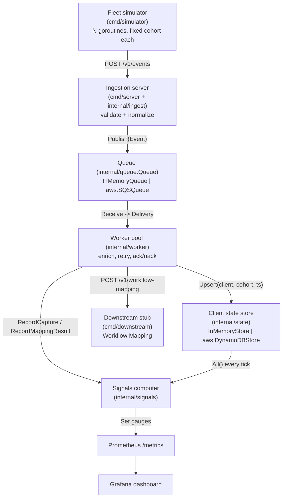

# FleetPulse architecture

## Scope

FleetPulse simulates a fleet of desktop-app / browser-extension clients
"phoning home," and builds real ingestion/observability muscle around that
simulated fleet. It does **not** build a real desktop app or browser
extension -- see the README's scope-control note. Nothing described here has
been run, built, or deployed as part of this scaffold; see README.md for the
full list of commands that would be run, and the explicit note that none of
them have been executed yet.

## Components

| Component | Path | Role |
|---|---|---|
| Fleet simulator | `cmd/simulator`, `internal/simulator` | Spins up N goroutines, each a simulated client with a fixed cohort (version/os/region), emitting heartbeats/captures/errors over HTTP. Owns the `--kill-cohort` demo scenario. |
| Ingestion server | `cmd/server`, `internal/ingest` | Accepts `POST /v1/events`, validates and normalizes payloads, publishes onto the queue. Exposes `/metrics` and `/healthz`. |
| Queue | `internal/queue`, `internal/aws` (SQS variant) | Buffered-channel-with-visibility-timeout in-process queue, or a LocalStack/real-SQS-backed queue behind the same interface. |
| Worker pool | `internal/worker` | Drains the queue, runs the (stubbed) enrichment step, updates client state, retries transient failures via nack/redelivery. |
| Signals computer | `internal/signals` | Periodically computes heartbeat freshness, capture completeness, and mapping availability; exposes them (and pipeline health) as Prometheus metrics. |
| Client state store | `internal/state`, `internal/aws` (DynamoDB variant) | Per-client last-seen/last-heartbeat record, in-memory or DynamoDB-backed. |
| Downstream stub | `cmd/downstream`, `internal/downstreamclient` | Stands in for the "Workflow Mapping" dependency; supports on-demand failure/latency injection for the mapping-availability demo. |

## Request / data flow

```
                         ┌─────────────────────────┐
                         │   Fleet simulator        │
                         │  (cmd/simulator)         │
                         │  N goroutines, each a    │
                         │  fixed-cohort client     │
                         └────────────┬─────────────┘
                                      │ POST /v1/events
                                      │ (heartbeat | capture | error, batched JSON)
                                      ▼
                         ┌─────────────────────────┐
                         │   Ingestion server        │
                         │  (cmd/server + internal/  │
                         │   ingest)                 │
                         │  - decode batch            │
                         │  - Normalize() / validate  │
                         │  - reject malformed        │
                         └────────────┬─────────────┘
                                      │ Publish(ctx, Event)
                                      ▼
                         ┌─────────────────────────┐
                         │        Queue               │
                         │ internal/queue.Queue        │
                         │  ┌───────────────────────┐  │
                         │  │ InMemoryQueue          │  │  (default: local dev)
                         │  │ buffered chan +        │  │
                         │  │ visibility timeout     │  │
                         │  └───────────────────────┘  │
                         │  ┌───────────────────────┐  │
                         │  │ internal/aws.SQSQueue  │  │  (LocalStack / real AWS)
                         │  └───────────────────────┘  │
                         └────────────┬─────────────┘
                                      │ Receive() → Delivery{Ack,Nack}
                                      ▼
                         ┌─────────────────────────┐
                         │      Worker pool           │
                         │  (internal/worker)          │
                         │  - Upsert client state       │
                         │  - Enrich() (stub; calls      │
                         │    downstream for captures)   │
                         │  - Ack on success              │
                         │  - Nack on transient failure    │──────┐
                         │  - (dead) on retry exhaustion     │     │ HTTP
                         └──────┬───────────────┬───────────┘     │ POST /v1/workflow-mapping
                                │               │                  ▼
                                │               │        ┌─────────────────────┐
               Upsert(client,   │   Record{Capture,       │  Downstream stub     │
               cohort, ts)      │    MappingResult}        │  (cmd/downstream)    │
                                ▼               ▼          │  - normal: 200 OK     │
                    ┌─────────────────┐  ┌─────────────┐   │  - admin-injectable:  │
                    │  Client state    │  │  Signals    │   │    failure_rate,      │
                    │  store            │  │  computer   │   │    timeout, hard-down  │
                    │ internal/state    │  │ internal/   │   └─────────────────────┘
                    │  ┌─────────────┐  │  │ signals     │
                    │  │InMemoryStore│  │  │  - freshness │
                    │  └─────────────┘  │  │  - completeness│
                    │  ┌─────────────┐  │  │  - mapping avail│
                    │  │DynamoDBStore│  │  └──────┬──────┘
                    │  └─────────────┘  │         │
                    └─────────────────┘          │ Set gauges
                                                   ▼
                                        ┌─────────────────────┐
                                        │  Prometheus /metrics  │
                                        │  (cmd/server)          │
                                        └──────────┬───────────┘
                                                    │ scrape
                                                    ▼
                                        ┌─────────────────────┐
                                        │      Prometheus       │
                                        └──────────┬───────────┘
                                                    │ query
                                                    ▼
                                        ┌─────────────────────┐
                                        │       Grafana          │
                                        │ (FleetPulse Overview   │
                                        │  dashboard)             │
                                        └─────────────────────┘
```

## Mermaid equivalent (renders on GitHub)



## Why a queue sits between ingestion and processing

This mirrors the KYC-normalization project's "unreliable upstream ->
normalize -> downstream" shape, inverted: instead of a few unreliable
vendors, FleetPulse has many small, individually unreliable senders (the
simulated fleet). Decoupling ingestion from processing behind a queue means:

- A slow or failing enrichment step (or downstream dependency) doesn't
  block the HTTP response to a client -- ingestion just needs to durably
  accept and enqueue.
- A worker crashing mid-processing doesn't lose the event: it comes back via
  the queue's visibility-timeout redelivery (see `internal/queue`'s package
  doc, and `docs/runbook.md` for how this is meant to be demoed on camera by
  killing a worker mid-run).
- Backlog and in-flight counts become a first-class, directly observable
  signal of pipeline health (`fleetpulse_queue_backlog`,
  `fleetpulse_queue_in_flight`), rather than something you'd have to infer
  from latency alone.

## LocalStack bootstrap (not run in this scaffold)

To exercise the `internal/aws` implementations against LocalStack, the queue
and table need to exist first. These are the commands that would create
them (using the `awslocal` CLI wrapper, or plain `aws --endpoint-url
http://localhost:4566`):

```bash
awslocal sqs create-queue --queue-name fleetpulse-events
awslocal dynamodb create-table \
  --table-name fleetpulse-client-state \
  --attribute-definitions AttributeName=client_id,AttributeType=S \
  --key-schema AttributeName=client_id,KeyType=HASH \
  --billing-mode PAY_PER_REQUEST
```

Then run `cmd/server` with `FLEETPULSE_QUEUE_BACKEND=sqs`,
`FLEETPULSE_STATE_BACKEND=dynamodb`, `FLEETPULSE_SQS_QUEUE_URL`,
`FLEETPULSE_DYNAMODB_TABLE`, and `AWS_ENDPOINT_URL=http://localhost:4566` set
(see `docker-compose.yml`'s commented-out block on the `server` service).
None of this has been executed as part of this scaffold.
