# FleetPulse in a real company: end-to-end walkthrough

**Audience:** backend engineers reading this repo, and product managers who
will never open a `.go` file. Every step below is written twice: once in plain
English (skip to the bold line), once as an engineering walkthrough with
diagrams, exact file pointers, and the architectural principle behind it.

**Honest status reminder (from `README.md`):** this repository is a portfolio
scaffold. Every file is real, substantive code, but nothing has been built,
run, or tested. Treat file/line references as "where the code lives today,"
not "verified working behavior." Line numbers were verified against the
current tree at the time of writing.

---

## Who would actually run this

FleetPulse is shaped for exactly one class of company: **you ship software to
machines you do not control, you cannot SSH into, and you cannot force-update it fast.** Your only questions are "is it alive," "did its data arrive," and
"is the thing its data flows through still up."

| Company (type) | Their "fleet" | The cohort failure that would hurt them | The signal they'd live on |
|---|---|---|---|
| **1Password** (password manager: desktop app + browser extension) | Millions of installs across Windows/macOS/Linux + Chrome/Firefox/Edge/Safari | A new client build breaks sync on one OS; heartbeats stop, users just think "it's slow" | Heartbeat freshness by `version/os/region` |
| **Grammarly** (browser extension + desktop keyboard) | Extension installs phoning home with capture traffic | A Chrome MV3 migration drops capture fragments silently while typing still "works" | Capture completeness |
| **Figma Desktop / Notion / Slack / Postman** (Electron apps) | Desktop installs that auto-update on the vendor's schedule, not yours | A bad Chromium bump bricks one channel; no crash report ever arrives | Heartbeat freshness (absence of signal) |
| **Zoom** (desktop client) | Client fleet rolled out by IT admins, not by Zoom | The 2020 macOS update that broke audio for a slice of Mac users; only visible as "calls failing on darwin" | Per-OS cohorts, exactly what `ingest.Cohort{Version, OS, Region}` encodes |
| **Adobe Creative Cloud / JetBrains** (toolchains with beta channels) | Version-weighted adoption: most users on the last stable, a tail on beta | Beta channel goes dark; aggregate health stays >90% and hides it | Per-cohort labeling (the whole point of `docs/signals.md`) |
| **CrowdStrike Falcon / any endpoint agent** | Agents on endpoints you don't own | **July 2024: 8.5M Windows machines bricked by a content update - the fleet couldn't even report its own death.** This is the literal `--kill-cohort` scenario | "Absence of signal *is* the signal" |
| *(downstream side)* **Sentry / Datadog / Amplitude** | The dependency a pipeline calls to enrich events | The enrichment API rate-limits you; data arrives but processing stalls | Mapping availability |

**The running example used throughout this document:** a Grammarly-shaped
vendor with a 300-install-limited beta cohort (`2.6.0-beta`, ~8% of the fleet)
shipping to testers, whose update breaks networking. That is FleetPulse's one
demoed incident (`docs/runbook.md`), and it maps 1:1 onto the CrowdStrike and
Zoom class of real-world failure.

**The system in one glance** (every step below highlights its own box):

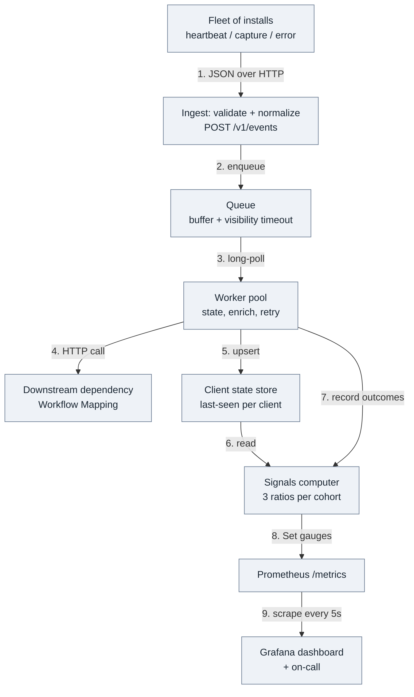

---

# Step 1 — The fleet phones home

**Product manager, in one line:** every installed copy of our software sends a
tiny "I'm alive" message every 30 seconds, plus occasional batches of data and
error reports - and we can't force any of them to do anything.

### 1) Plain English

You shipped an app or an extension. It now lives on 300,000 machines you will
never touch. Each copy is *assigned a cohort* (app version + OS + region) once,
at install, and never changes it. On a 30-second timer each client POSTs a
**heartbeat** ("I'm alive"), and now and then also a **capture session** ("here
are 3-8 numbered fragments of data I promised, `expected_event_count` = N") or
an **error** ("disk write failed: ENOSPC").

The critical realism: **a client that dies does not send a goodbye message.**
It just stops. That is why "absence of signal" has to be a first-class
signal, and why this repo simulates exactly that (`--kill-cohort`).

### 2) How it works

In this repo the sender is `cmd/simulator`: N goroutines, each a fixed-cohort
fake client. Everything downstream of the HTTP endpoint cannot tell the
difference between that and a real client, which is the deliberate scope
tradeoff (`README.md` "Scope") - building the real desktop app would prove
nothing the observability stack doesn't already prove.

- **Cohort shape** (`internal/simulator/cohort.go`): version pool
  `2.4.0 / 2.5.0 / 2.5.1 / 2.6.0-beta`, OS pool `windows / macos / linux`,
  region pool `us-east / us-west / eu / apac`. Versions are drawn with weights
  `55 / 25 / 12 / 8` - "most of the fleet on newest stable, a real tail on the
  previous two, and a small beta channel." That 8% beta tail is deliberately
  small enough that an aggregate dashboard would barely move when it dies.
- **Traffic mix** (`internal/simulator/simulator.go`, `DefaultConfig`): 300
  clients, 30s heartbeat, 15% chance per tick of starting a capture session,
  3% chance of an error, and **8% per-fragment capture loss** injected so
  completeness realistically sits below 1.0 instead of pinned at 100%.
- **Per-client loop** (`internal/simulator/client.go`): a random initial delay
  spreads boot across one full interval (no thundering herd), then a ticker
  fires `tick()` -> heartbeat, maybe a capture session (3-8 fragments,
  sequence numbers `0..N-1`, each fragment independently droppable), maybe an
  error.
- **The kill switch** (`runKillCohortTimer` + `internal/simulator/silence.go`):
  after `--kill-cohort-after` (default 2m), the target version is added to a
  shared `SilencedCohorts` set. Every client checks that set on every tick and
  simply does nothing - modeled as "the networking broke," not "the client
  politely announced retirement." Unsilencing is possible in principle, which
  makes recovery demoable.

### 3) Diagrams

**High level — where this step sits:**

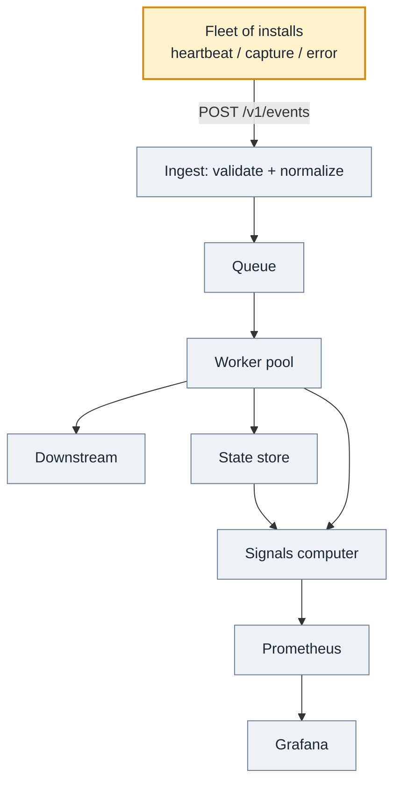

**Low level — one client's tick loop and the silence gate:**

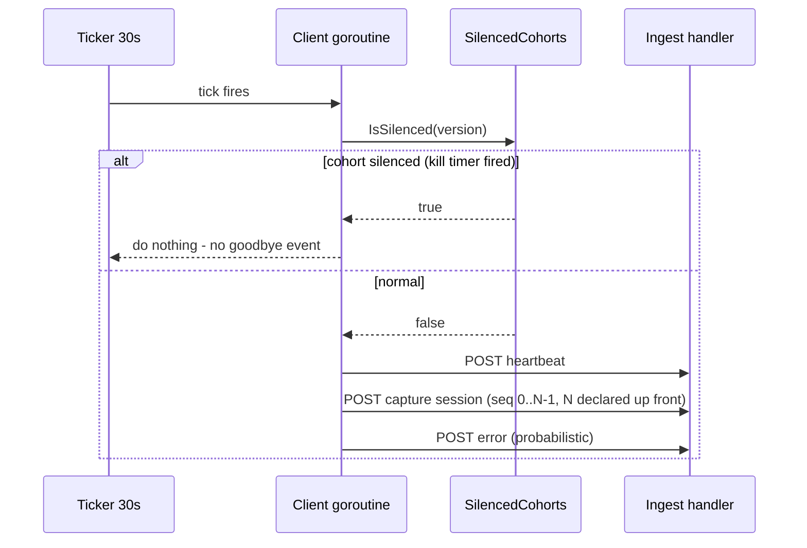

**Cohort distribution (why 8% matters):**

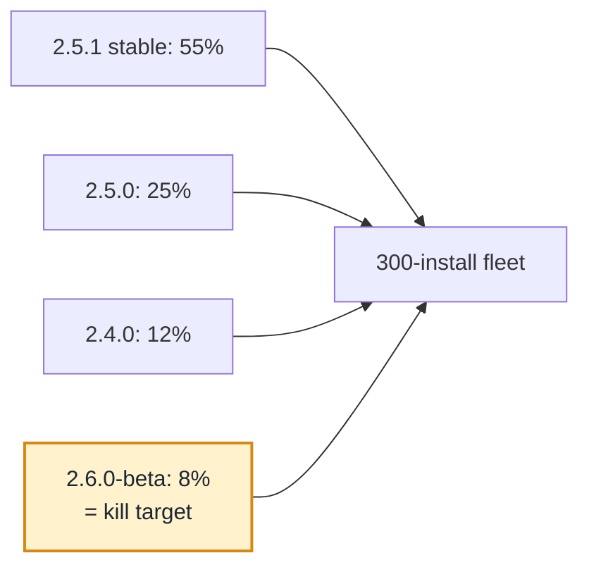

### 4) Where it lives in the repo

| What | File(s) |
|---|---|
| CLI flags / env wiring (`--clients`, `--kill-cohort`, `--ingest-url`) | `cmd/simulator/main.go` (config built at :48-54) |
| Fleet config defaults (300 clients, 30s, 15%/3%/8%) | `internal/simulator/simulator.go:48-59` |
| Cohort pools + adoption-curve weights | `internal/simulator/cohort.go:13-17`, `cohort.go:31-45` |
| Spawn loop (fixed cohort per client, goroutine per client) | `internal/simulator/simulator.go:95-108` |
| **Per-client run loop** (stagger, ticker, silence gate) | `internal/simulator/client.go:59-88` (gate at :77) |
| `tick()` -> heartbeat/capture/error emission | `internal/simulator/client.go:90-106`, `:108-164` |
| HTTP transport (5s timeout, non-2xx = error) | `internal/simulator/client.go:166-188` |
| **Kill-cohort timer** | `internal/simulator/simulator.go:110-116`, `:130-140` |
| Silence registry (`Silence` / `Unsilence` / `IsSilenced`) | `internal/simulator/silence.go:17-42` |
| Wire payload type the fleet speaks | `internal/ingest/types.go:52-69` (`RawEvent`) |

**If you were changing this for real:** replace `internal/simulator` with the
real client SDK. Nothing else changes - that is the point of the boundary. If
you need a new event type, you change `internal/ingest/types.go` (the enum)
and the client, and you leave the queue/worker/signals alone until you know
what the new event *means*.

### 5) Engineering pattern / architectural principle

> **Simulation as an abstraction boundary (contract-first telemetry):** the
> fleet is an implementation of a wire contract, not a component of the
> product. Anything that speaks `POST /v1/events` correctly is a valid fleet
> member - a goroutine, a real desktop app, or a chaos-testing script.

Corollary principle: **absence of signal is itself a signal.** Systems whose
participants you don't control must be able to answer "what *stopped*
arriving," not just "what arrived."

### 6) Design patterns and decisions - and why they matter

- **Immutable cohort assignment at spawn** - a client's `version/os/region`
  never changes for its lifetime (`client.go`, `cohort.go`). *Why:* every
  signal is a ratio *over cohorts*; a client that could migrate between
  cohorts mid-session would make "which slice degraded" ambiguous exactly when
  you need it unambiguous.
- **Weighted random sampling instead of uniform** (`versionWeights`, 55/25/12/8)
  - *why it matters:* uniform sampling would give the beta channel 25% of the
  fleet and destroy the very failure mode being demoed (a small cohort dying
  under a healthy aggregate). Real adoption curves are lopsided; the simulator
  reproduces that so the dashboard has something honest to hide.
- **Probabilistic fault injection** (8% fragment loss, 15% capture rate) -
  *why:* a completeness signal pinned at 1.0 can't be trusted to detect a
  regression, because you can't distinguish "working" from "not measuring."
- **Staggered start** (`initialDelay` random over one interval,
  `client.go:62`) - classic thundering-herd avoidance; 300 (or 300k) clients
  hitting the ingest endpoint on the same tick would create a load spike that
  has nothing to do with reality.
- **Cooperative cancellation via a shared registry** (`SilencedCohorts`
  guarded by `sync.RWMutex`, checked per tick) rather than killing goroutines -
  *why it matters:* you can un-silence and demo **recovery**, and the failure
  looks like a network outage (silent) rather than a crash (which would be a
  different, wrong signal).
- **Honest boundary comments everywhere** (e.g. `README.md` scope note,
  `simulator.go` package doc). *Why for the PM:* this repo is explicit about
  what it does not prove. In a real org, that boundary is what stops a
  stakeholder from asking "so does this mean our iOS app is covered?"

---

# Step 2 — The front door: validate and normalize

**Product manager, in one line:** garbage data from a broken client build gets
rejected at the door with a countable reason, so the rest of the system only
ever handles data it can trust - and a spike in rejections is itself an
incident signal.

### 1) Plain English

The server listens on `POST /v1/events`. It accepts either a single event or
an array of up to **500** events. Each event is checked against hard rules
(has an ID? valid type? timestamp parseable and not more than 5 minutes in the
future? capture has a session ID and a sane sequence number?). Bad events are
rejected with a machine-readable reason; good events are converted into one
canonical internal format. The response tells the client exactly how many were
accepted and how many were rejected, with reasons.

Why the PM cares: **a bad release that starts sending malformed timestamps
shows up as a rejection spike before it shows up as lost data** - and the
on-call checklist says to look at exactly that first (`docs/runbook.md`,
Step 2.1).

### 2) How it works

- **Routes** (`cmd/server/main.go`): `/v1/events` -> ingest handler, `/metrics`
  -> Prometheus, `/healthz` -> `200 ok`. Plain `http.NewServeMux`, no
  middleware chain.
- **Transport gates** (`internal/ingest/handler.go`): non-POST -> `405`;
  undecodable JSON -> `400` + `rejected{decode_error}`; empty batch -> `400` +
  `rejected{empty_batch}`; more than 500 events -> `400` +
  `rejected{batch_too_large}`. The decode step sniffs `[` vs `{` so both a
  single object and an array work.
- **Per-event validation + normalization** (`internal/ingest/validate.go`,
  `Normalize()`): strict on `client_id`, `type`, `timestamp`, `version`;
  lenient on `os` and `region` (canonicalized via lookup maps, else
  `"unknown"` - never rejected, because an unknown OS is still a real user).
  Specific rules: timestamp must parse as RFC3339 and must not be **>5 minutes
  in the future**; captures require `session_id`, `expected_event_count > 0`,
  and `0 <= sequence_number < expected_event_count`; errors require a message,
  truncated at 2048 bytes rather than rejected.
- **Two wire types, deliberately** (`internal/ingest/types.go`): `RawEvent`
  (everything a string, nothing trusted - the *untrusted* schema) and `Event`
  (typed, normalized, stamped with server-observed `ReceivedAt` - the
  *trusted* schema). `Event` carries no JSON tags: it is never marshaled by
  `encoding/json` in-process; the SQS path defines its own wire type.
- **Response semantics:** `202 Accepted` if anything was accepted, `400` if
  nothing was, with body `{accepted, rejected, errors[]}` - a *partial*
  success response, so one bad event in a batch doesn't cost you the other 499.

### 3) Diagrams

**High level:**

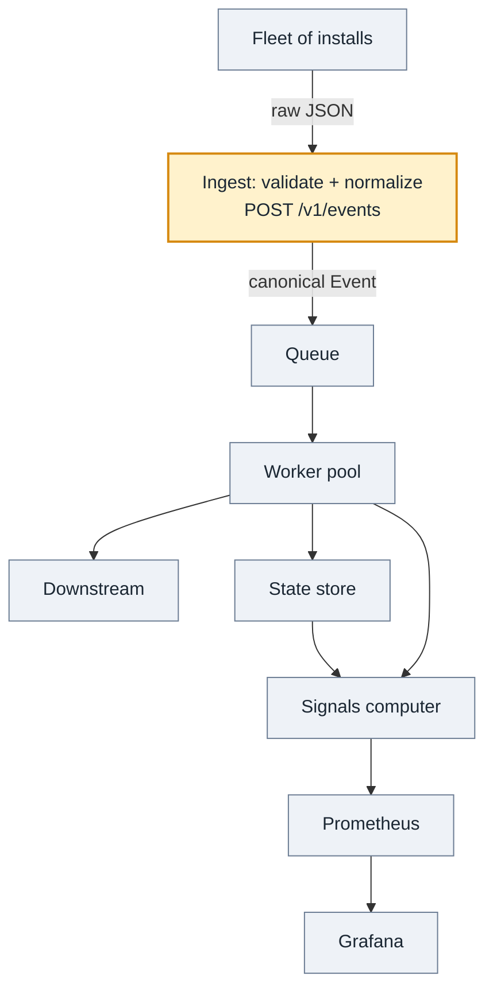

**Low level — one request's path through the handler:**

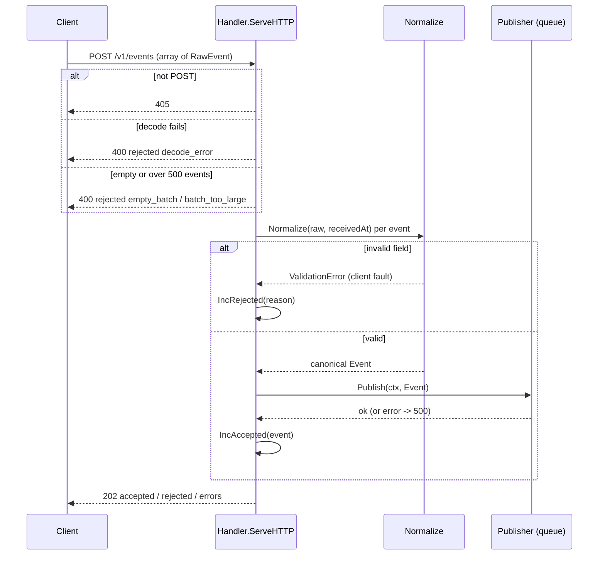

### 4) Where it lives in the repo

| What | File(s) |
|---|---|
| **Route registration** | `cmd/server/main.go:80` - `mux.Handle("/v1/events", ingestHandler)` |
| **HTTP handler** | `internal/ingest/handler.go:53` - `(*Handler).ServeHTTP` |
| Batch size limit (500) | `internal/ingest/handler.go:46` |
| Body decode (object-or-array sniff) | `internal/ingest/handler.go:115-140` (`decodeEvents`) |
| Response shape | `internal/ingest/handler.go:106-110` (`ingestResponse`) |
| **Validation/normalization** | `internal/ingest/validate.go:47` - `Normalize` |
| Future-timestamp anti-gaming rule | `internal/ingest/validate.go:68-70` |
| OS/region canonicalization maps | `internal/ingest/validate.go:14-29`, helpers `:123-144` |
| `ValidationError` (maps to HTTP 400) | `internal/ingest/validate.go:34-41` |
| **Wire schema** (`RawEvent` untrusted, `Event` trusted, `Cohort`) | `internal/ingest/types.go:14-84` |
| Narrow ports the handler depends on | `internal/ingest/handler.go:15-25` (`Publisher`, `Metrics`) |

**Where you'd change it:**
- *Add a field to the wire contract* -> `internal/ingest/types.go` (both
  types), `validate.go` (rule), then `internal/aws/sqs_queue.go:24-74`
  (`wireEvent`) if it must survive the queue.
- *Add a new event type* -> enum in `types.go:17-20`, branch in
  `validate.go:89-113`.
- **Known gap to fix before production:** `decodeEvents` has **no byte-size
  limit** (no `http.MaxBytesReader`); `batchLimit` bounds event *count*, not
  bytes. A single multi-MB body would be fully buffered by the JSON decoder.
  Fix at `internal/ingest/handler.go:115-140`.
- **Known gap:** the endpoint is unauthenticated. A real deployment needs
  mTLS or per-install tokens at `cmd/server/main.go:80` (middleware in front
  of `ingestHandler`) - otherwise anyone can poison your signals.

### 5) Engineering pattern / architectural principle

> **Parse, don't validate - at the boundary (anti-corruption layer).**
> Untrusted input is converted into a trusted domain type exactly once, at
> the edge of the system. Everything downstream is *allowed to assume
> validity*.

Related principle: **fail fast on client fault, fail loud on server fault.**
`ValidationError` is a 400 (your fault, don't retry the same payload); a
publish failure is a 500 (our fault, retry).

### 6) Design patterns and decisions - and why they matter

- **Schema boundary: `RawEvent` (all strings) -> `Normalize` -> `Event`
  (typed).** *Why:* the queue, worker pool, and signals computer only ever
  see `Event`. The blast radius of a malformed payload - or of a future
  protocol migration (`docs/roadmap.md`) - is contained to one function. When
  the team later adds `schema_version`, only `Normalize` learns about it.
- **Canonicalization over rejection for low-stakes fields.** `win32`/`darwin`/
  `osx` map to `windows`/`macos`; unknown values become `"unknown"` rather
  than 400. *Why:* rejecting a user because their OS string is novel turns a
  cosmetic mismatch into a fleet-wide data outage - and `"unknown"` is itself
  a visible cohort on the dashboard.
- **Signal-integrity validation:** rejecting timestamps >5 minutes in the
  future (`validate.go:68`). *Why it matters:* a client with a wrong clock
  could otherwise report heartbeats from the future and inflate
  `heartbeat_freshness_ratio` forever. This is the guard that lets
  `docs/signals.md` promise the signal can't be gamed. **Validation is not
  hygiene here; it's what makes the metric trustworthy.**
- **Per-batch `ReceivedAt` stamped once** (`handler.go:76`) and carried into
  every `Event`. *Why:* server-observed time is the only clock you control;
  client-asserted `Timestamp` is preserved for forensics but never trusted for
  freshness math.
- **Partial acceptance (`202` with `{accepted, rejected}`)** instead of
  all-or-nothing. *Why:* one corrupt event in a 500-event batch must not cause
  the client to retry (and duplicate) the whole batch.
- **Interface segregation at the edge:** the handler depends on
  `ingest.Publisher` (one method) and `ingest.Metrics` (two methods), not on
  the full queue. *Why:* the HTTP layer can be unit-tested with a fake
  publisher and never learns what a queue is.
- **Lenient decode, strict validate.** Decoding never fails on unknown JSON
  keys; validation fails on semantic errors. *Why:* clients add fields before
  servers know about them - strict decoding would make every client release a
  server outage.

---

# Step 3 — The buffer: a queue between accepting and processing

**Product manager, in one line:** we take the client's data and reply
instantly, then process it in the background - so a slow or broken downstream
service can never make clients time out or lose data.

### 1) Plain English

The HTTP request's job ends the moment the event is durably handed off.
Processing (updating state, calling the enrichment service, computing
signals) happens later, on a separate set of workers. If a worker crashes
halfway through an event, the event is not lost: the queue hands it to someone
again. If a message is broken so badly that processing it always fails, it is
capped at 5 attempts and parked where it can't block the rest.

### 2) How it works

- **The port** (`internal/queue/queue.go`): a four-method `Queue` interface -
  `Publish`, `Receive`, `Metrics`, `Close` - plus a `Delivery` handle with
  `Ack` / `Nack`. The doc comment is explicit that the contract is **modeled
  on SQS semantics on purpose**, so the in-memory and real-SQS implementations
  can be driven by identical worker code.
- **Visibility timeout** = 10s (`internal/queue/inmemory.go:16`). When a worker
  receives a message it becomes invisible to other workers for 10 seconds.
  Ack = permanent delete. Nack = make it visible again immediately. If the
  worker dies without acking, a background **reaper** (500ms ticker,
  `inmemory.go:164`) returns it to the ready list - that is crash recovery,
  for free, with no "detect dead worker" logic anywhere in the codebase.
- **Redelivery cap** = 5 (`DefaultMaxDeliveries`, `inmemory.go:22`). After 5
  deliveries a message goes to the dead-letter list so a poison message can't
  cycle forever.
- **In-memory implementation detail:** the backlog is a `[]Message` slice
  guarded by a `sync.Mutex`, with a capacity-1 `notify chan struct{}` used as
  a non-blocking wakeup for sleeping receivers (`inmemory.go:77-91, 152-157`).
  (Note: the README describes this as a "buffered channel"; the actual
  implementation is slice + mutex + notify channel. The *interface* is what
  matters; the README wording is slightly ahead of the code.)
- **The adapter at the edge** (`cmd/server/main.go:116-125`):
  `publisherAdapter` narrows the 4-method `Queue` down to the 1-method
  `ingest.Publisher`, so `internal/ingest` never imports the queue package.
- **Queue health is observable:** `Backlog`, `InFlight`, `DeadLettered` counts
  are a first-class part of the `Queue` interface, polled every 2s by the
  worker pool and exported as gauges - backlog is a *signal*, not a log line.

### 3) Diagrams

**High level:**

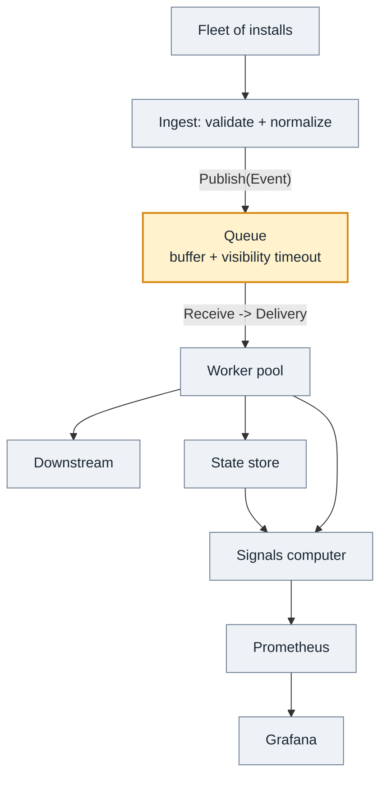

**Low level — the lifecycle of one message:**

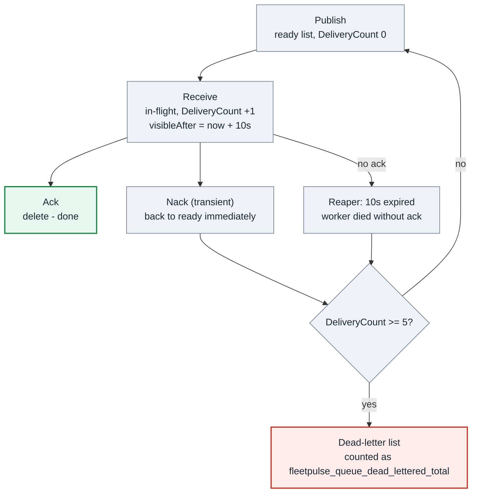

### 4) Where it lives in the repo

| What | File(s) |
|---|---|
| **`Queue` interface (the port)** | `internal/queue/queue.go:77-92` |
| **`Delivery` interface (Ack/Nack)** | `internal/queue/queue.go:47-58` |
| SQS-mirroring rationale comment | `internal/queue/queue.go:36-46` |
| In-memory impl: `Publish` / `Receive` | `internal/queue/inmemory.go:77` / `:93` |
| Visibility timeout (10s) + reaper | `internal/queue/inmemory.go:16`, `:164-195` |
| Redelivery cap (5) + nack-to-DLQ | `internal/queue/inmemory.go:22`, `:204-221` |
| **Handler -> queue adapter** | `cmd/server/main.go:116-125` |
| Queue metrics surfacing | `internal/queue/inmemory.go:136-144` -> `internal/worker/pool.go:168-186` |

**Where you'd change it:**
- *Change retry policy* -> cap at `internal/queue/inmemory.go:22`; the
  worker-side branch at `internal/worker/pool.go:128`.
- **Known gap to fix:** there is **no backoff**. A nack immediately
  re-queues and wakes a worker (`inmemory.go:204-221`), so a transiently
  failing dependency is hammered at full speed. Add exponential backoff with
  jitter in the nack path (or per-message `visibleAfter`).
- **Known gap:** the in-memory DLQ has no replay consumer - dead-lettered
  messages are only surfaced as a count. A real deployment needs a replay
  tool (SQS gives you this with a redrive policy; the in-memory impl needs a
  `DrainDeadLetter()`-style API).

### 5) Engineering pattern / architectural principle

> **Store-and-forward decoupling (producer-consumer):** accept fast, process
> later. The queue converts a *latency coupling* problem (client waits for
> our whole pipeline) into an *availability* problem (we keep accepting while
> the pipeline is sick).

Underlying delivery contract: **at-least-once delivery.** Exactly-once is not
offered; the design instead makes duplicates harmless (see Step 7 and Step 8:
monotonic state updates, set-based sequence counting).

### 6) Design patterns and decisions - and why they matter

- **Ports and adapters, with the queue's *semantics* specified in the port's
  doc comment.** The interface is deliberately SQS-shaped so the local dev
  queue and the production queue are interchangeable. *Why it matters:* the
  worker pool has **zero** backend branches; you can run the full pipeline on
  a laptop with no AWS, and run the identical code in production. That kills
  the classic "works locally, differs in prod" class of bug.
- **Visibility timeout as implicit failure detector.** *Why:* the alternative
  - heartbeats between workers, lease renewal, dead-worker detection - is a
  distributed-systems subproject. Piggybacking on the queue's own redelivery
  gets crash safety with no extra moving parts. The comment at
  `queue.go:41-46` states exactly this tradeoff.
- **Interface segregation via `publisherAdapter`.** *Why:* `internal/ingest`
  compiles and tests against a 1-method interface; the queue can be refactored
  freely without touching the HTTP layer. This is the Dependency Inversion
  Principle applied at package granularity.
- **Dead-letter cap as a circuit breaker for poison messages.** *Why:* without
  it, one event that always fails processing permanently consumes worker
  capacity. With it, the failure is *quarantined and counted*
  (`fleetpulse_queue_dead_lettered_total`) instead of hidden.
- **Backlog/in-flight exposed through the interface, not inferred.** *Why for
  the PM:* "is the system keeping up?" becomes a number on a panel instead of
  an engineering guess - and it's the second thing on-call checks during an
  incident (`docs/runbook.md` Step 2.2: is this freshness dip real, or just a
  queue backlog?).
- **Decision to keep the in-memory queue in-process rather than embed
  something like NATS/Redis.** *Why:* zero-dependency local dev and CI. The
  cost is honesty about limits (no durability across restart, no DLQ replay),
  which the package doc states outright (`internal/queue/inmemory.go:33-36`).

---

# Step 4 — Swappable durability: memory for dev, SQS/DynamoDB for real

**Product manager, in one line:** the same code runs on a laptop with zero
setup and in the cloud on managed AWS services - we flip two environment
variables, and nothing about how the product behaves changes.

### 1) Plain English

There are two backends behind every durable thing in this system:

- **`memory`** (default): a Go map / slice inside the process. Instant to
  start, nothing to install, **everything is lost if the process restarts.**
  Right for local development, demos, and CI.
- **`sqs` / `dynamodb`**: Amazon SQS for the queue and DynamoDB for
  client state. Survives restarts, scales without code changes, costs money,
  needs infrastructure. Right for production - and for LocalStack locally,
  which is a fake AWS in a container.

The choice is made at startup by environment variables
(`FLEETPULSE_QUEUE_BACKEND=memory|sqs`,
`FLEETPULSE_STATE_BACKEND=memory|dynamodb`). Both implementations are compiled
into the same binary - there are no build tags.

### 2) How it works

- **Factory functions** (`cmd/server/main.go:130-174`): `buildQueue` and
  `buildStateStore` switch on the env var and return the *interface*. Unknown
  value or missing required companion var (`FLEETPULSE_SQS_QUEUE_URL`,
  `FLEETPULSE_DYNAMODB_TABLE`) fails fast at startup with a clear error -
  misconfiguration is a boot failure, not a runtime surprise.
- **Endpoint override as the single LocalStack/real-AWS decision point**
  (`internal/aws/config.go:68-83`): if `AWS_ENDPOINT_URL` is set, both AWS
  clients point at it (LocalStack on `http://localhost:4566`); if unset, the
  SDK talks to real AWS. Credentials default to LocalStack's dummy
  `test/test` pair when none are provided (`config.go:45-66`).
- **SQS queue** (`internal/aws/sqs_queue.go`): `Publish` = `SendMessage` with
  an **explicit `wireEvent` JSON type** plus `MessageAttributes`
  (`event_type`, `version`) for future filtering; `Receive` = long-poll
  `ReceiveMessage` (capped at 10 messages / 20s wait, mirroring the in-memory
  semantics) reading `ApproximateReceiveCount` into `Message.DeliveryCount`;
  `Ack` = `DeleteMessage`; `Nack` = `ChangeMessageVisibility{Timeout: 0}`;
  dead-lettering is delegated to the SQS queue's **redrive policy** rather
  than reimplemented. Queue/table creation is out of scope - it's an
  init-script/Terraform job (`sqs_queue.go:97-100`), with the bootstrap
  commands documented in `docs/architecture.md:157-164`.
- **DynamoDB store** (`internal/aws/dynamodb_store.go`): table
  `fleetpulse-client-state`, partition key `client_id`. `Upsert` uses
  `UpdateItem` with `if_not_exists(registered_at, ...)` so concurrent workers
  can't clobber first-seen, and the update expression only sets
  `last_heartbeat_at` when the event actually *is* a heartbeat. `All()` is a
  paginated full **Scan** - the code comment says plainly this is "the wrong
  access pattern at real fleet scale" and that a `(version,
  last_heartbeat_at)` GSI is what production needs.
- **Compose default** (`docker-compose.yml:32-41`): ships `memory`/`memory`,
  with the six LocalStack env vars present but commented out - flip them to
  exercise the AWS path.

### 3) Diagrams

**High level — one binary, two backends:**

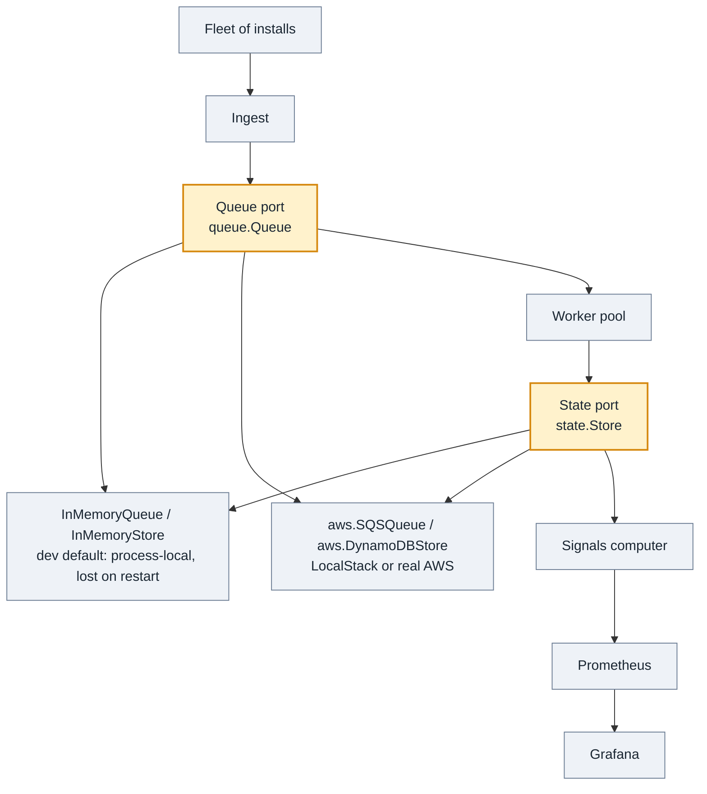

**Low level — how SQS mirrors the in-memory contract:**

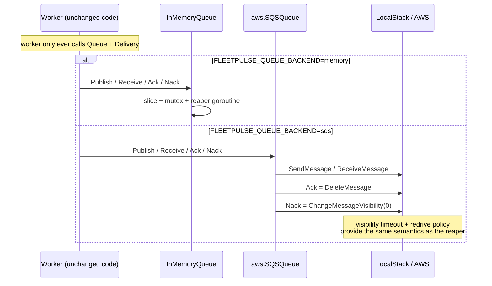

### 4) Where it lives in the repo

| What | File(s) |
|---|---|
| **Backend selection (queue)** | `cmd/server/main.go:130-151` (`buildQueue`) |
| **Backend selection (state)** | `cmd/server/main.go:155-174` (`buildStateStore`) |
| Env var contract documented | `cmd/server/main.go:10-15` |
| LocalStack vs real-AWS decision | `internal/aws/config.go:68-83` (`Endpoint()`), credentials `:45-66` |
| **SQS impl of `queue.Queue`** | `internal/aws/sqs_queue.go:118` (Publish), `:138` (Receive), `:237` (Ack), `:251` (Nack), `:201` (Metrics) |
| Explicit SQS wire type | `internal/aws/sqs_queue.go:24-74` (`wireEvent`) |
| **DynamoDB impl of `state.Store`** | `internal/aws/dynamodb_store.go:72` (Upsert), `:129` (All), `:165` (Get) |
| LocalStack service + commented flip block | `docker-compose.yml:73-87`, `docker-compose.yml:32-41` |
| Bootstrap commands (create queue/table) | `docs/architecture.md:157-164` |

**Where you'd change it:**
- *Move to GCP Pub/Sub or Kafka* -> implement `queue.Queue` +
  `queue.Delivery` in a new package; touch nothing else.
- *Fix the DynamoDB full-scan* -> add a GSI on `(version,
  last_heartbeat_at)` and rewrite `All()` at
  `internal/aws/dynamodb_store.go:129-163`.
- *Fix blind heartbeat overwrite in DynamoDB* -> `dynamodb_store.go:86-98`
  sets `last_heartbeat_at` unconditionally; the in-memory store enforces
  monotonic max (`internal/state/state.go:71-76`). Make them agree.

### 5) Engineering pattern / architectural principle

> **Dependency inversion / the Strategy pattern chosen by configuration:**
> high-level policy (worker pool, signal computer) depends on abstractions
> (`queue.Queue`, `state.Store`); the concrete strategy is injected once at
> the composition root from configuration, never referenced downstream.

Deployment principle: **the dev/prod parity gap is a configuration diff, not a
code diff.**

### 6) Design patterns and decisions - and why they matter

- **Anti-corruption layer over the AWS SDK.** The AWS types never leak:
  `wireEvent` exists specifically because the authors refused to let
  `encoding/json`'s default `time.Time` handling silently become the
  cross-process contract (`sqs_queue.go:19-23`). *Why it matters:* the day
  `ingest.Event` is refactored, in-flight SQS messages must not become
  unparseable. Explicit wire types are cheap insurance for any system with a
  durable buffer.
- **The in-memory implementation doubles as an executable specification.**
  Because both implementations satisfy one interface whose semantics are
  written down (visibility timeout, delivery count, ack/nack), the local one
  is a *reference model* for the cloud one. *Why:* you can write the worker
  pool against the reference model and have reasonable confidence it will
  behave against SQS - and you can test SQS-specific behavior against
  LocalStack without touching real AWS.
- **Runtime switch, not build tags.** Both backends ship in one binary. *Why
  it matters operationally:* one artifact to build, scan, sign, and roll out;
  environment decides behavior (the 12-factor position). The cost is a
  slightly larger binary and AWS SDK dependencies always in the build graph.
- **Fail fast at boot on misconfiguration** (missing queue URL when
  `QUEUE_BACKEND=sqs` returns an error from `buildQueue`). *Why:* a queue
  backend that silently falls back to memory in production is a data-loss bug
  that looks like success for 30 seconds.
- **Delegate, don't reimplement: SQS redrive policy owns dead-lettering.**
  *Why:* SQS's DLQ has retry accounting, metric alarms, and a console; the
  in-memory path reimplements only what it must (a slice and a counter). This
  is the "don't build an unbounded platform" scope discipline from
  `README.md` applied to infrastructure.
- **`if_not_exists` + conditional update instead of read-modify-write.**
  *Why:* 8 workers upsert the same client concurrently; DynamoDB's atomic
  update expression prevents lost updates without an application-level lock.
- **Honest TODOs in production-shaped code** (Scan-is-wrong comment,
  blind-set-heartbeat comment). *Why for both audiences:* a scaffold that
  hides its own scaling limits is worse than one that names them - the
  reviewer sees judgment, not just syntax.

---

# Step 5 — Workers: process, enrich, retry, dead-letter

**Product manager, in one line:** a pool of background workers drains the
queue; transient failures are retried automatically, hopeless ones are parked
and counted, and nothing blocks the clients.

### 1) Plain English

Eight goroutines sit in a loop: pull up to 10 messages (waiting up to 2
seconds if there's nothing), process each one in order, then go back for
more. Processing a single event means: (1) update the client's last-seen
record, (2) run enrichment - which for capture events means calling the
downstream service, (3) if this is a capture, record how complete the session
is.

If something fails, the worker decides: **transient** (the downstream service
hiccuped - retry it) or **permanent** (the state store is broken / retries
exhausted - stop trying). Retries are capped at 5 deliveries; after that the
message is dead-lettered and the failure becomes a visible number instead of a
hidden loop.

### 2) How it works

- **Pool config** (`internal/worker/pool.go:30-44`): `NumWorkers: 8`,
  `ReceiveBatch: 10`, `ReceiveWait: 2s`, `MetricsInterval: 2s`. `Run()`
  spawns one metrics-reporter goroutine plus 8 worker goroutines, all joined
  by a `WaitGroup`, all cancelled by the process `ctx`.
- **Pull model, no central dispatcher:** each worker independently calls
  `q.Receive(...)`. There is no shared work channel - backpressure is the
  queue's problem, which keeps the pool trivially scalable.
- **The decision tree** (`pool.go:112-148`):
  - success -> `Ack`, count `outcome="success"`;
  - error wraps `ErrTransient` **and** `DeliveryCount < 5` -> `Nack`,
    count `outcome="retry"`, increment `fleetpulse_worker_retries_total`;
  - otherwise -> log "dead-lettering", count `outcome="dead_letter"`, `Nack`.
- **Retry classification by sentinel error** (`internal/worker/errors.go`):
  only `errors.Is(err, ErrTransient)` is retried. The enricher marks its
  simulated hiccups and all downstream failures as transient
  (`enrich.go:77`, `:93`); a state-store failure propagates as permanent.
- **Work order inside `handleEvent` (`pool.go:152-166`) - this ordering is a
  design decision, not an accident:**
  1. `store.Upsert(...)` - *always runs first, for every event type*;
  2. `enricher.Enrich(...)` - calls downstream for captures;
  3. `computer.RecordCapture(evt)` - only reached if enrichment succeeded.
  Consequence: **a downstream outage cannot freeze heartbeat freshness**
  (step 1 already committed the last-seen record), but it *does* stall
  capture completeness (step 3 never runs). That asymmetry is what makes the
  dashboard able to tell "our dependency is down" from "the fleet is dying."
- **Per-event instrumentation:** `ProcessingDuration` histogram observed on
  every attempt; counters by `type,outcome`; queue gauges copied every 2s.

### 3) Diagrams

**High level:**

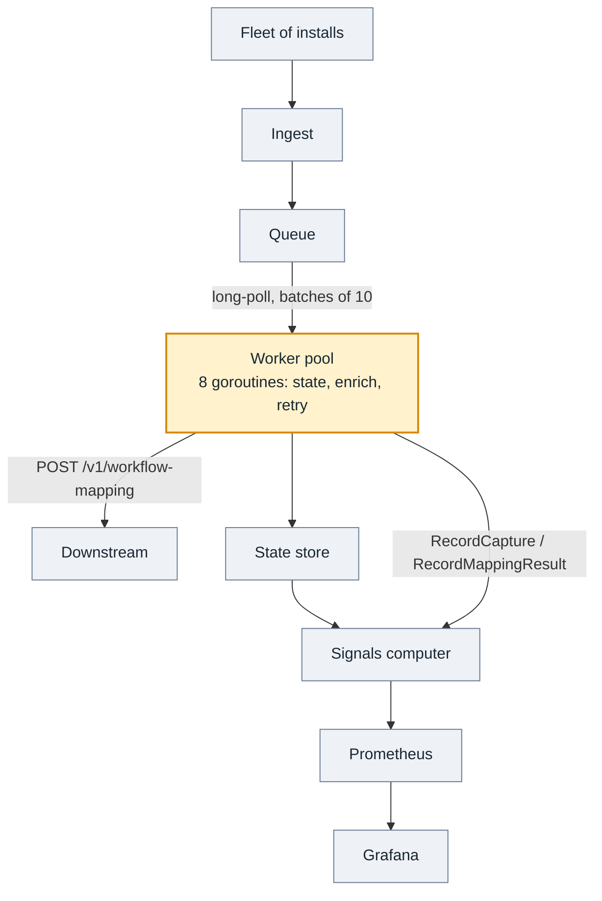

**Low level — process one delivery, with the retry path:**

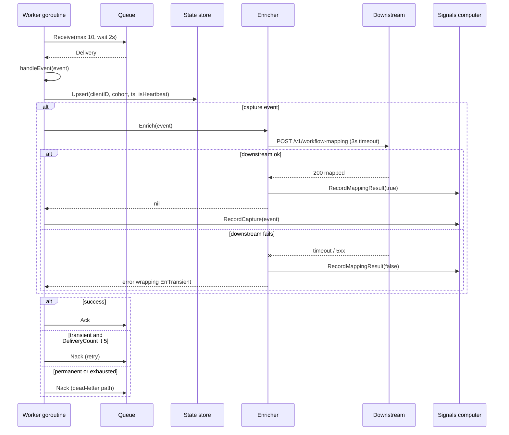

### 4) Where it lives in the repo

| What | File(s) |
|---|---|
| **Pool constructor + config** | `internal/worker/pool.go:30-57` (`DefaultConfig` at :37) |
| **Run loop / goroutine spawn** | `internal/worker/pool.go:66-85` |
| Per-worker pull loop | `internal/worker/pool.go:87-110` |
| **Retry / DLQ decision** | `internal/worker/pool.go:112-148` (branch at :128) |
| **Per-event work order** | `internal/worker/pool.go:152-166` |
| Queue-metrics reporter (2s) | `internal/worker/pool.go:168-186` |
| **Transient-error sentinel + classifier** | `internal/worker/errors.go:10-15` |
| **Enricher port + stub impl** | `internal/worker/enrich.go:21-49`, impl `:53-105` |
| Downstream call site (captures only) | `internal/worker/enrich.go:82-96` |
| Wiring: pool started as goroutine | `cmd/server/main.go:75`, `:96` |
| Enricher failure/latency knobs | `cmd/server/main.go:73` (3% transient, 50ms) |

**Where you'd change it:**
- *Worker concurrency / batch size* -> `internal/worker/pool.go:37-44`.
- *Retry policy* -> `pool.go:128` (and add backoff - see Step 3's gap).
- *New enrichment step* (real normalization, ML classification, dedupe)
  -> implement `worker.Enricher` (`enrich.go:21`) and swap it at
  `cmd/server/main.go:73`. The worker pool doesn't change.
- *Reorder side effects* (e.g. record captures before enrichment) ->
  `pool.go:152-166` - but read the ordering rationale above first.

### 5) Engineering pattern / architectural principle

> **Worker pool with explicit fault classification:** every failure is sorted
> into *retryable* or *terminal* before any retry decision is made. Retrying
> a terminal failure is a bug; never retrying a transient one is an outage.

Plus: **ordering of side effects encodes business priority.** Writing state
before enrichment means the "is the fleet alive" signal is more durable than
the "is the data complete" signal.

### 6) Design patterns and decisions - and why they matter

- **Sentinel error + `errors.Is` as control flow** (`ErrTransient`). *Why:*
  retry policy is decided in exactly one place (`pool.go:128`) instead of
  being scattered across every error branch, and a future enricher
  automatically gets correct retries by wrapping the sentinel. This is the
  Go idiom for a fault taxonomy, and it's cheaper than a typed error enum
  with a `Retryable()` method.
- **Pull-based consumers over a central dispatcher.** *Why:* no scheduler to
  scale or fail; adding workers adds throughput linearly; idle workers cost a
  blocked `Receive`, not a heartbeat loop. This is the same shape SQS/Kafka
  consumer groups give you for free.
- **Deterministic work order (state -> enrich -> record).** *Why it matters
  for incident response:* when downstream dies, freshness stays green and
  completeness stalls - two panels diverge, and divergence is a diagnosis. If
  the order were reversed, one outage would flatten every signal and tell you
  nothing about *which* layer broke (`docs/signals.md` leans on this
  explicitly when contrasting signals 1 and 3).
- **`sync.WaitGroup` + `context.Context` lifecycle, no daemon registry.**
  *Why:* shutdown is one `ctx` cancel (SIGTERM at
  `cmd/server/main.go:51`), and the process can't leak goroutines - every
  background loop in the repo is cancellable through the same root context.
- **Metrics recorded at the failure site, not derived later.** `outcome` is
  labeled `success|retry|dead_letter` at the moment of the decision
  (`pool.go:120-147`). *Why:* post-hoc inference from logs can't tell you how
  many retries happened; counters can, and `docs/runbook.md` step 2 relies on
  reading them during triage.
- **Stub enricher with injected latency + failure rate as a standing load
  test.** *Why:* the retry path is exercised continuously (3% of events)
  instead of only during an incident, so a regression in retry logic shows up
  as a metric drift, not as a surprise during a real outage.
- **Known quirk to be aware of:** the `outcome="dead_letter"` counter fires
  at the worker's decision point, but the queue still redelivers until
  `DeliveryCount` hits 5 - so the metric can lead the actual DLQ by up to 4
  deliveries. The comment at `pool.go:144-146` concedes the queue owns
  bookkeeping. If you fix one thing here, make the metric and the queue agree.

---

# Step 6 — The downstream dependency: Workflow Mapping

**Product manager, in one line:** capture data has to pass through another
company's (or another team's) service before it's useful, so we measure that
service's health separately - because "users' data isn't showing up" looks
identical for both problems until you look at the dashboard.

### 1) Plain English

For every capture event the worker calls an external HTTP service that maps
raw fragments to canonical workflow actions (in real life: sessionization,
enrichment, dedup, sending to the data warehouse). This repo ships a tiny
standalone stub for it with an admin endpoint that can make it fail on demand
- so the demo can prove that a dependency outage is *distinguishable* from a
client fleet outage.

That distinction is the entire reason signal #3 exists: from a support
ticket's point of view, "our pipeline's dependency is down" and "8% of
clients went dark" both sound like "the data isn't showing up," and a good
dashboard must separate them in seconds (`docs/signals.md`, section 3).

### 2) How it works

- **The call** (`internal/worker/enrich.go:82-96`): only **capture** events
  call downstream (`case ingest.EventCapture`). Heartbeats and errors skip it.
  Payload: `{client_id, session_id, sequence_number}`. Timeout: **3s**
  (`cmd/server/main.go:72`). Both outcomes are recorded:
  `computer.RecordMappingResult(err == nil)` runs on success *and* failure.
- **Failure collapse** (`internal/downstreamclient/client.go:55-88`): transport
  error, non-200 status, and (separately) decode error are folded into
  `ErrDownstreamUnavailable` / a wrapped error, then reclassified as
  *transient* at `enrich.go:93` - so downstream failures enter the Step 5
  retry path rather than dead-lettering good events.
- **The stub** (`cmd/downstream/main.go`): routes
  `POST /v1/workflow-mapping`, `GET /healthz`, `GET|POST /admin/config`.
  `handleMap` can inject latency (`timeout_ms`), probabilistic 500s
  (`failure_rate` 0..1), or a hard outage (`down:true`) - e.g.
  `curl -X POST localhost:8090/admin/config -d '{"failure_rate": 0.6,
  "timeout_ms": 3000}'`.
- **Why a separate process, explicitly:** the package doc says the stub exists
  so the signal measures "a downstream dependency health, not FleetPulse's own
  uptime, so it's modeled as a genuine outbound HTTP call rather than an
  in-process stub that can never actually go down."

### 3) Diagrams

**High level:**

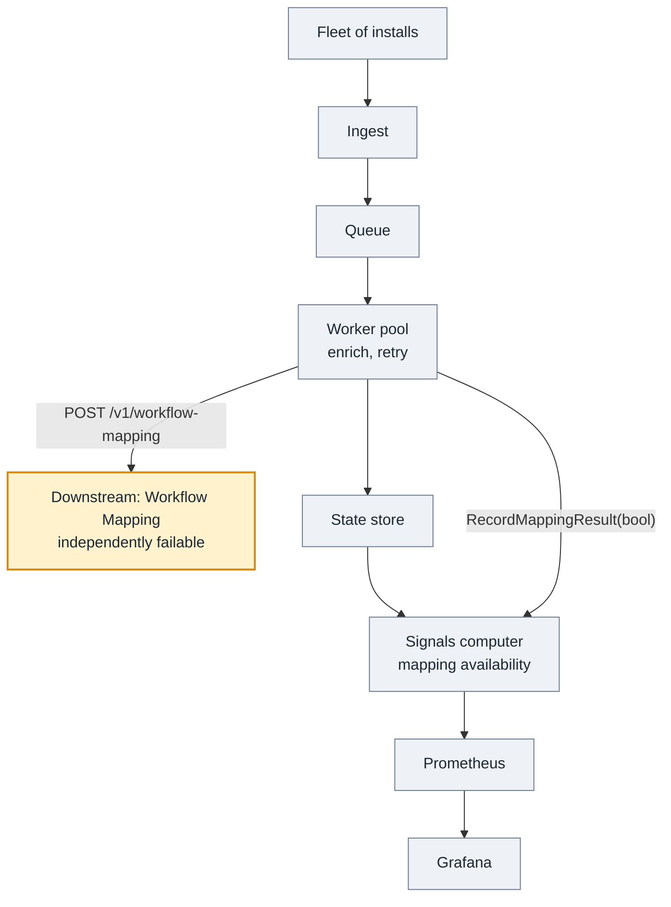

**Low level — success, failure injection, and retry:**

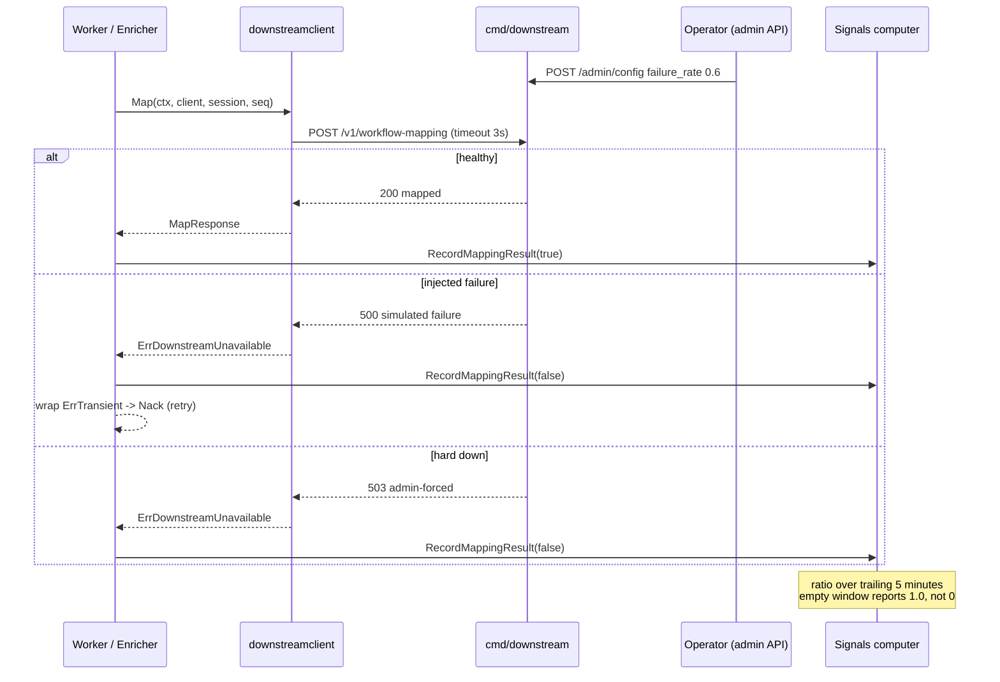

### 4) Where it lives in the repo

| What | File(s) |
|---|---|
| **HTTP client for the dependency** | `internal/downstreamclient/client.go:60-88` (`Map`), timeout default `:27-29` |
| Sentinel `ErrDownstreamUnavailable` | `internal/downstreamclient/client.go:55` |
| **Call site inside enrichment** | `internal/worker/enrich.go:82-96` (captures only: `:65-74`) |
| Recording outcomes into signals | `internal/worker/enrich.go:88` -> `internal/signals/signals.go:91-93` |
| Client construction (3s timeout) | `cmd/server/main.go:72` |
| **Stub service routes** | `cmd/downstream/main.go:80-82` |
| **Mapping handler** | `cmd/downstream/main.go:102-142` |
| **Failure-injection admin API** | `cmd/downstream/main.go:149-172` |
| Compose service | `docker-compose.yml:64-71` |

**Where you'd change it:**
- *Point at the real enrichment service* -> set
  `FLEETPULSE_DOWNSTREAM_URL` (`cmd/server/main.go:55`); adapt the payload
  type at `internal/downstreamclient/client.go:38-48` if the real API differs.
- *Add a second dependency* (e.g. feature flags, symbolication) -> add a
  second client, and give `fleetpulse_mapping_availability_ratio` a
  `dependency` label (`internal/signals/metrics.go:50-53`) as
  `docs/signals.md:143-146` already anticipates.
- *Make failures permanent (don't retry)* -> change the wrap at
  `enrich.go:93`; usually wrong, because a dependency blip shouldn't cost you
  the event.

### 5) Engineering pattern / architectural principle

> **Measure dependencies at the call site, as a first-class signal.** Your
> system's health is the conjunction of your health and your dependencies';
> observability that only covers your own process will misattribute every
> dependency outage to yourself (or to your users).

Design principle behind the stub: **an in-process fake can't prove anything
about availability signals**, because it physically cannot go down.

### 6) Design patterns and decisions - and why they matter

- **Ports and adapters again:** `worker.Enricher` is the port; the HTTP
  client is the adapter. *Why:* enrichment is the step most likely to become
  real work (a real service call, an ML model, a rules engine). Isolating it
  behind a one-method interface means swapping it doesn't touch retry logic,
  metrics, or the queue.
- **Collapsing many failure modes into one availability bit.** Transport
  error, 5xx, and timeout all become "unavailable." *Why:* the signal is
  *availability*, not *error taxonomy*; a dependency-health metric with 40
  label values is unusable in an alert. Detailed errors go to logs, not to
  the ratio.
- **Trailing 5-minute window instead of cumulative success rate**
  (`internal/signals/mapping.go:41-56`, window set at
  `signals.go:62`). *Why it matters during an incident:* an all-time average
  takes forever to visibly recover - after a 10-minute outage on a week of
  100% uptime the number barely moves, so "is the fix working?" has no fast
  answer. A trailing window recovers within 5 minutes of the fix.
- **Empty window reports `1.0`, not `0.0`** (`mapping.go:46-48`). *Why:*
  "no calls yet" (fresh process, no captures yet) and "every call failed" are
  different states; conflating them makes every deploy page the on-call team.
  This is a deliberate "don't let a signal lie about its own health" rule,
  the same rule `docs/signals.md` applies to future-timestamp rejection.
- **Record both outcomes unconditionally** (`RecordMappingResult(err == nil)`
  runs even on success). *Why:* a ratio needs a denominator; only recording
  failures would give you a count you can't turn into availability.
- **Fault injection as a product feature of the stub** (`/admin/config`).
  *Why for the PM:* thresholds are worthless until you've watched one be
  crossed and recovered on screen. This endpoint exists so the demo can show
  `99.5% -> 0% -> recovery` deliberately rather than waiting for a real
  outage - it's a game-day button.
- **Timeout budget (3s) chosen shorter than the queue's 10s visibility
  timeout.** *Why:* a worker must finish or fail within the message's
  visibility lease, otherwise the message gets redelivered while still being
  processed (duplicate work). Keeping dependency timeouts well under the
  visibility timeout is the rule that makes at-least-once delivery safe.

---

# Step 7 — Client state: the "last-seen" store

**Product manager, in one line:** for every install we remember when we last
heard its heartbeat versus when we last heard *anything* - two different
clocks that answer two different questions.

### 1) Plain English

To answer "is this cohort alive," something has to remember, per client: when
did we last get a heartbeat, when did we last get any event, which cohort is
it in, and which session is it in. That's a small record per client, updated
every time a worker processes an event.

Two clocks, not one:
- **`LastHeartbeatAt`** moves only on heartbeat events -> "is it alive?"
- **`LastEventAt`** moves on anything -> "is it active, or just quiet?"

A client that heartbeats perfectly but sends no captures is *alive*; a client
that stops heartbeating is *dark*. Merging these into one timestamp would make
those two states indistinguishable.

### 2) How it works

- **The port** (`internal/state/state.go:32-50`): three methods - `Upsert`,
  `All`, `Get`. The doc comment notes the signals package and worker pool are
  the consumers, mirroring `internal/queue`'s "two implementations, one
  interface" structure.
- **Who writes:** the **worker pool**, not the ingest handler
  (`internal/worker/pool.go:153-154`), for every event type, *before*
  enrichment. That placement is what makes freshness independent of downstream
  health (Step 5).
- **Who reads:** the signals computer, via `All()` once per 10s tick - a full
  snapshot read, then bucketed by cohort in memory.
- **Monotonic merge:** `Upsert` only advances a timestamp if the incoming one
  is newer (`state.go:71-76`). Redelivered (duplicate) messages therefore
  can't move a clock backwards - this is the idempotency half of the
  at-least-once contract from Step 3.
- **Two implementations:** `InMemoryStore` (`sync.RWMutex` + map) and
  `aws.DynamoDBStore` (table `fleetpulse-client-state`, PK `client_id`,
  `UpdateItem` with `if_not_exists` for `registered_at`).
- **Note:** `Get(clientID)` is defined and used by the runbook as an operator
  step ("pull the specific client's record, see its heartbeat frozen at the
  kill moment") but is not called anywhere in code today - it's a debugging
  API surface, not dead weight.

### 3) Diagrams

**High level:**

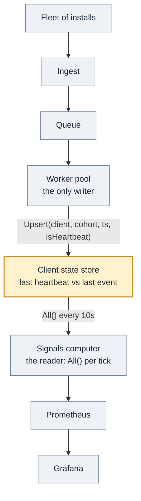

**Low level — one record under duplicate delivery and concurrent workers:**

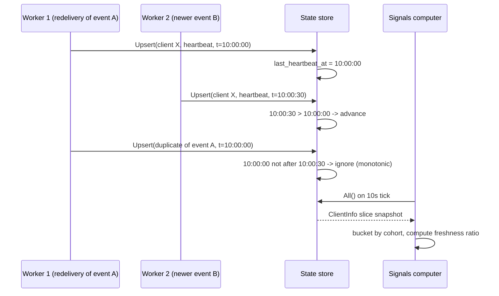

### 4) Where it lives in the repo

| What | File(s) |
|---|---|
| **`Store` interface** | `internal/state/state.go:32-50` |
| **`ClientInfo` record** (two clocks) | `internal/state/state.go:22-29` |
| In-memory impl (monotonic merge) | `internal/state/state.go:53-99` (`Upsert` at :62) |
| **Write site (worker, pre-enrichment)** | `internal/worker/pool.go:152-156` |
| **DynamoDB impl** | `internal/aws/dynamodb_store.go:72-120` (Upsert), `:129-163` (All), `:165-188` (Get) |
| Read site (signals) | `internal/signals/signals.go:126` (`store.All(ctx)`) |
| Backend selection | `cmd/server/main.go:155-174` |
| Operator debugging step using `Get` | `docs/runbook.md:79` |

**Where you'd change it:**
- *Add a field* (e.g. install source, license tier) -> `ClientInfo`
  (`state.go:22-29`), `Upsert` signature (`state.go:39`), both
  implementations, and the call site `pool.go:154`.
- **Known gap to fix:** DynamoDB's `All()` is a full table Scan
  (`dynamodb_store.go:122-163`) - fine for hundreds/thousands of clients,
  wrong at 10M. Add the `(version, last_heartbeat_at)` GSI noted in the
  schema comment (`dynamodb_store.go:29-33`) and query per cohort.
- **Known divergence to fix:** DynamoDB blind-sets `last_heartbeat_at`
  (`dynamodb_store.go:86-98`) where memory enforces max - under redelivery a
  stale value could regress the clock in the AWS path only.

### 5) Engineering pattern / architectural principle

> **Repository pattern (a read model behind an interface), with write/read
> separation:** writers are the workers processing the live event stream;
> readers are signal computations over snapshots. Neither knows the other.

Underlying principle: **idempotent, monotonic updates are the price of
at-least-once delivery.** If you accept duplicate messages (Step 3), your
state layer must make duplicates harmless.

### 6) Design patterns and decisions - and why they matter

- **Two timestamps for two questions.** *Why it matters:* "alive but doing
  nothing interesting" and "dark" are different incidents with different
  owners (one is normal; one is a bad release). A single `last_seen` field
  conflates them and makes the foundational signal (freshness) ambiguous.
- **The worker writes, not the HTTP handler.** *Why:* state updates then
  benefit from queue retry semantics for free - a failed write is a nack and
  a redelivery, with no retry logic in the request path. The flip side: state
  lags the wire by queue latency, which is exactly why `docs/runbook.md`
  Step 2.2 tells you to check backlog before believing a freshness dip.
- **`isHeartbeat bool` as an explicit parameter rather than inferring from
  event type inside the store.** *Why:* the store stays domain-agnostic (it
  doesn't need to know the full event-type enum), which keeps the interface
  small and the DynamoDB expression simple.
- **Snapshot read (`All()`) instead of a query-per-cohort.** *Why:* one call
  per 10s tick, then in-memory bucketing - trivially cheap at this scale, and
  it keeps the signals computer free of storage-specific query syntax. The
  honest cost is documented where it breaks (the Scan + GSI note), which is
  the right way to make a scale-dependent decision.
- **`if_not_exists(registered_at)` in DynamoDB.** *Why:* under concurrent
  upserts from 8 workers, first-seen must be write-once; a read-modify-write
  in application code would race, an atomic update expression cannot.
- **RWMutex for the in-memory store.** *Why:* the read pattern (one `All()`
  every 10s) and write pattern (continuous upserts) are asymmetric - a
  read-write lock lets the snapshot read proceed without serializing every
  worker write behind a single exclusive lock longer than necessary.

---

# Step 8 — Signals: three numbers per cohort

**Product manager, in one line:** every 10 seconds we publish three
percentages - is the fleet alive, did its data arrive, is our dependency up -
each with a written target, a warning threshold, and a page threshold, so
nobody has to argue about what "bad" means at 3am.

### 1) Plain English

Raw metrics (requests, errors, latency) are for engineers. Signals are for
decisions. FleetPulse defines exactly three, all ratios between 0 and 1, all
labeled by cohort (`version`, `os`, `region`):

1. **Heartbeat freshness** - "Is this cohort even still there?" = of the
   clients in a cohort, what fraction heartbeat within the last 60 seconds?
   Target **>= 99.0%**; page below 95% for 5m, *or* below 50% for any single
   cohort >1% of fleet for 2m.
2. **Capture completeness** - "Did its data actually arrive?" = per session,
   distinct fragments received divided by the count the client *declared it
   would send*, averaged per cohort. Target **>= 97%**; page below 90% for
   15m. (97, not 100, because real networks drop fragments - the simulator
   injects 8% loss on purpose.)
3. **Mapping availability** - "Is the thing downstream of us up?" = successful
   dependency calls / total, over a trailing 5 minutes. Target **>= 99.5%**;
   page below 90% for 2m, or instantly at 0%.

The PM artifact here is `docs/signals.md`: for each signal, the formula, the
*justification for the window*, the thresholds, and the known ways the signal
itself can lie. That document is treated by this repo as more important than
the code.

### 2) How it works

- **Computation loop** (`internal/signals/signals.go:96-118`): `Computer.Start`
  ticks every 10s (started once, immediately, so `/metrics` is never empty),
  and each `tick` runs the three computations in order. Inputs arrive two
  ways: **push** (worker/enricher call `RecordCapture` /
  `RecordMappingResult` per event) and **pull** (`store.All()` snapshot per
  tick) - a hybrid aggregation model.
- **Freshness** (`signals.go:125-155`): bucket every client by cohort; a
  client is fresh if `now - LastHeartbeatAt <= FreshnessWindow` where
  `FreshnessWindow = 60s` = exactly **2x the 30s heartbeat interval**
  (`signals.go:27`) - one missed beat of slack for jitter/redelivery, and
  derived from the client's own p99 interval rather than picked aesthetically.
  Denominator = all clients known for that cohort (a client seen only via a
  capture counts as stale - correct, it isn't heartbeating).
- **Completeness** (`signals.go:161-200`): per `session_id`, keep a **set** of
  distinct `sequence_number`s against the client-declared
  `expected_event_count`, ratio clamped to 1.0, averaged across sessions per
  cohort, with sessions older than 30 minutes pruned. Set-not-counter means a
  queue redelivery (Step 3) can't inflate it - the at-least-once contract
  shows up here as correctness. The denominator is the client's own
  declaration, so a drop unambiguously means "they said N, we got < N"
  (`docs/signals.md:106-113` explains why a server-side estimate would
  silently absorb client-side regressions).
- **Mapping availability** (`internal/signals/mapping.go`): a slice of
  `{at, success}` samples with head-prune on a 5-minute window; empty window
  -> 1.0.
- **Anti-gaming:** future timestamps were already rejected at ingest
  (Step 2), which is what lets freshness claim it can't be inflated.
- **Publishing** (`internal/signals/metrics.go`): 11 collectors, all
  registered once against a private registry - the three signal gauges plus
  ingest counters, queue gauges, worker counters/histogram.

### 3) Diagrams

**High level:**

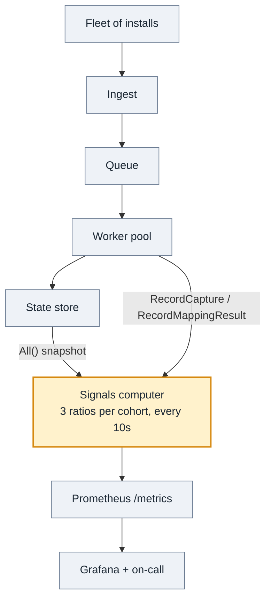

**Low level — one 10-second tick:**

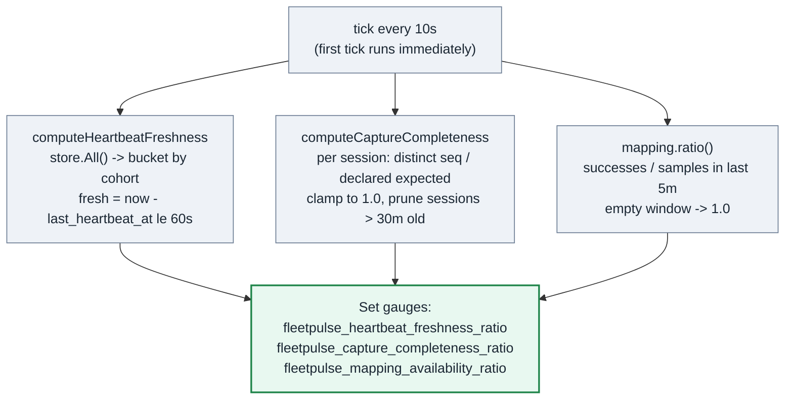

**The three signals as a decision table:**

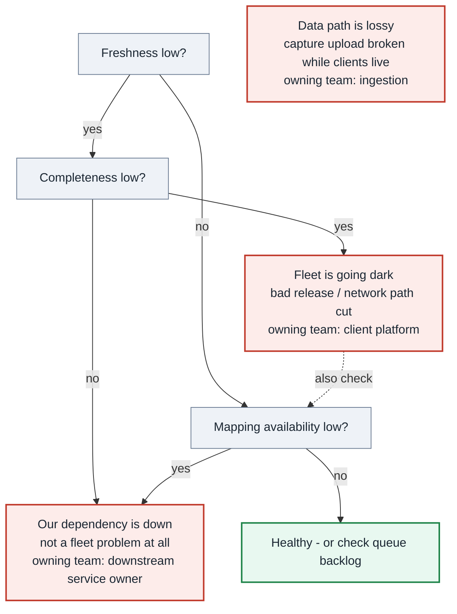

### 4) Where it lives in the repo

| What | File(s) |
|---|---|
| **Signal definitions "why"** | `docs/signals.md` (formulas, thresholds, window justifications) |
| Freshness window (60s) | `internal/signals/signals.go:27` |
| **Freshness computation** | `internal/signals/signals.go:125-155` |
| **Completeness computation** | `internal/signals/signals.go:161-200` (TTL prune `:174-177`, clamp `:181-184`) |
| Session progress intake | `internal/signals/signals.go:71-86` (`RecordCapture`) |
| Trailing-window tracker | `internal/signals/mapping.go:41-56` (`ratio`), `:59-68` (`prune`) |
| Ticker loop | `internal/signals/signals.go:96-118`; started at `cmd/server/main.go:97` |
| **Metric declarations (11)** | `internal/signals/metrics.go:19-101` (signal gauges `:42-53`) |
| Cohort label set | `internal/signals/metrics.go:12` (`version, os, region`) |

**Where you'd change it:**
- *Change a window or threshold* -> value in `internal/signals/signals.go`
  (window) and the prose in `docs/signals.md` (thresholds) - **and**, today,
  nowhere else, because **no alert rules exist** (see Step 9's gap).
- *Add signal #4 (per-cohort error rate)* -> `docs/roadmap.md:27-42`
  explains why it was deferred: content-based signals need a classification
  taxonomy first, otherwise a raw rate fires on benign errors. New compute
  func in `signals.go`, new gauge in `metrics.go`, new panel in the Grafana
  JSON.
- **Known gap to fix:** once a cohort's sessions age past the 30m TTL,
  `computeCaptureCompleteness` stops `Set`ting that cohort's gauge, so it
  **freezes at its last value** instead of decaying - which contradicts
  `docs/runbook.md:63-69` claiming completeness "should also fall toward
  zero" for a dead cohort. Fix: `Set(0)` or `Delete` the series when a cohort
  has no live sessions (`internal/signals/signals.go:194-199`).
- **Known gap:** `fleetpulse_queue_dead_lettered_total` is declared as a
  *Gauge* whose name ends in `_total` (`metrics.go:70-73`) - rename or
  retype before anyone puts a `rate()` on it.

### 5) Engineering pattern / architectural principle

> **Derived, decision-ready signals over raw telemetry.** A signal is a
> ratio with a defined denominator, a defined window, a stated target, and a
> stated way it can lie. Anything missing one of those is a metric, not a
> signal - and metrics don't page people.

Two supporting principles:
- **Bounded cardinality** (labels limited to `version/os/region`) - unbounded
  label sets are the #1 way Prometheus deployments die.
- **Trailing windows, never lifetime averages** - a signal that can't recover
  quickly can't answer "is it fixed yet?"

### 6) Design patterns and decisions - and why they matter

- **Per-cohort labeling as the load-bearing decision.** *Why - the PM
  version:* an 8% cohort going fully dark moves a fleet-wide average from
  100% to 92%, which most teams ignore. The same event, labeled by cohort, is
  "2.6.0-beta: 0%" - unignorable and immediately attributable to a release.
  `docs/runbook.md`'s postmortem note calls this the single most important
  design decision the runbook depends on.
- **Denominator choices are the real design work.** Freshness divides by
  *known clients*; completeness divides by the *client's own declaration*;
  mapping divides by *calls actually made*. *Why:* every misleading dashboard
  in existence is a denominator bug - "99% of users" measured against
  *active* users instead of *installed* users is how you ship a broken
  release to 40% of the fleet while the graph looks green.
- **Set-based sequence counting + clamp to 1.0** (`signals.go:34, :181-184`).
  *Why:* this is where at-least-once delivery (Step 3) would otherwise
  corrupt a signal - a redelivered fragment would double-count. Duplicates
  are made *invisible* rather than prevented.
- **Prune/TTL for in-memory accumulators** (30m session records). *Why:* the
  computer is a long-lived process; unbounded session maps are a memory leak
  that would eventually become an availability incident. TTL GC inside the
  compute pass keeps it allocation-simple. (Its side effect - frozen gauges -
  is the gap noted above.)
- **"No data = 1.0" for the dependency signal, "no heartbeat = 0" for the
  fleet signal.** These look inconsistent but are both correct: *absence of
  dependency calls* means we didn't need it (startup), while *absence of
  heartbeats* means the thing we're watching stopped existing. Knowing which
  absence is which is the difference between a pager that cries wolf and one
  nobody trusts.
- **Push inputs, pull snapshot, ticker publication.** *Why:* per-event work
  is O(1) and never blocks the hot path (it's a mutex-guarded map insert),
  while the expensive full-fleet computation happens at a fixed, bounded
  cadence instead of once per event. The tradeoff: signals lag reality by up
  to one tick (10s) - acceptable, because the thresholds all require 2-15
  minutes of sustained breach anyway.
- **Thresholds written as prose in `docs/signals.md` first, code second.**
  *Why for the org:* the threshold conversation ("is 97% right?") is a
  product/ops decision that happens *before* implementation, and writing the
  rationale down is what makes the alert defensible in a postmortem.

---

# Step 9 — Exposure: Prometheus, Grafana, and the dashboard contract

**Product manager, in one line:** there is one dashboard with six panels, the
top-left one is the panel you're meant to notice first, and the whole thing
- datasource, dashboard, scrape config - is checked into the repository, so
monitoring changes go through code review like any other change.

### 1) Plain English

The server exposes a `/metrics` URL that a Prometheus server scrapes every 5
seconds. Prometheus stores the time series; Grafana draws them. The provisioned
"FleetPulse Overview" dashboard has six panels: heartbeat freshness (top-left,
deliberately first), capture completeness, mapping availability, queue
backlog/in-flight/dead-lettered, ingest accepted vs rejected rates, and
worker outcomes. A Grafana instance auto-refreshes every 10 seconds.

For the PM: this is a **living dashboard, not a report.** Everything the
on-call engineer needs during the incident in Step 10 is on one screen, and
the dashboard's definition lives in git.

### 2) How it works

- **Private registry** (`cmd/server/main.go:57-58`): `prometheus.NewRegistry()`
  rather than the default global one, so `/metrics` contains *only* the 11
  `fleetpulse_*` collectors - no `go_*`/`process_*` noise, and registration is
  centralized so duplicate-registration panics are impossible (the rationale
  is written in `metrics.go:14-18`).
- **Exposition** (`cmd/server/main.go:81`): `promhttp.HandlerFor(registry)`
  mounted at `/metrics`; `/healthz` alongside for container healthchecks
  (used by compose's `server` healthcheck).
- **Scrape config** (`deploy/prometheus/prometheus.yml`): one job, target
  `server:8080`, `scrape_interval: 5s` - faster than the 10s gauge recompute,
  so the dashboard sees each gauge update promptly. **No `rule_files`** - see
  the gap below.
- **Dashboard as code** (`deploy/grafana/provisioning/`): datasource pointing
  at `http://prometheus:9090`, a dashboard provider, and
  `fleetpulse-overview.json` (six `timeseries` panels, `refresh: 10s`,
  `now-30m` window, percentunit axes 0-1 on the ratio panels). Grafana runs
  with anonymous Viewer access for demoing.
- **The metric inventory:** three signal gauges; ingest
  `accepted_total{type,version,os,region}` and `rejected_total{reason}`;
  queue `backlog` / `in_flight` / `dead_lettered`; worker
  `events_processed_total{type,outcome}`, `processing_duration_seconds`
  histogram, `retries_total`.

### 3) Diagrams

**High level:**

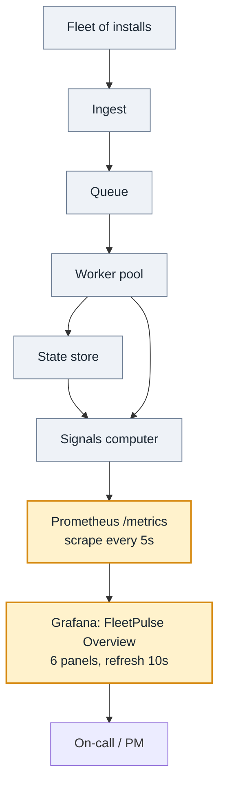

**Low level — scrape-to-panel path and dashboard layout:**

```mermaid
flowchart LR
    subgraph Server["cmd/server (one process)"]
        M["11 collectors in one private registry<br/>cmd/server/main.go:57-58"]
        H["GET /metrics<br/>cmd/server/main.go:81"]
        M --> H
    end
    subgraph Prom["Prometheus"]
        S["scrape every 5s<br/>deploy/prometheus/prometheus.yml"]
    end
    subgraph Graf["Grafana dashboard (grid order)"]
        P1["1. heartbeat freshness (top-left)"]
        P2["2. capture completeness (top-right)"]
        P3["3. mapping availability"]
        P4["4. queue backlog / in-flight / DLQ"]
        P5["5. ingest accepted vs rejected rates"]
        P6["6. worker outcomes by type"]
    end
    H --> S
    S --> P1
    S --> P2
    S --> P3
    S --> P4
    S --> P5
    S --> P6
```

### 4) Where it lives in the repo

| What | File(s) |
|---|---|
| Registry + metrics construction | `cmd/server/main.go:57-58` |
| **`/metrics` + `/healthz` routes** | `cmd/server/main.go:81-85` |
| All 11 metric declarations | `internal/signals/metrics.go:19-101` |
| Ingest counter adapter methods | `internal/signals/metrics.go:107-114` |
| **Scrape config** | `deploy/prometheus/prometheus.yml` |
| **Dashboard JSON (6 panels + PromQL)** | `deploy/grafana/provisioning/dashboards/fleetpulse-overview.json` |
| Dashboard provisioning | `deploy/grafana/provisioning/dashboards/dashboards.yml` |
| Datasource provisioning | `deploy/grafana/provisioning/datasources/datasource.yml` |
| Compose services (prometheus, grafana) | `docker-compose.yml:89-109` |

**Where you'd change it:**
- *Add a panel* -> edit `fleetpulse-overview.json` (gridPos + expr).
- **Known gap to fix, and it's the biggest one for production: there are no
  alert rules anywhere in the repo.** Every threshold in `docs/signals.md`
  exists only as prose; `prometheus.yml` has no `rule_files`, and no Grafana
  alert is configured. *Change:* add `deploy/prometheus/alerts.yml`
  (`fleetpulse_heartbeat_freshness_ratio{...} < 0.95 for 5m` etc.) and wire
  `rule_files` into `deploy/prometheus/prometheus.yml`, plus an Alertmanager/
  PagerDuty route. Until then, a human must be watching panel 1.
- *Add default Go collectors* (heap, goroutines) if you want process health -
  one `prometheus.NewGoCollector()` line at `cmd/server/main.go:57`.

### 5) Engineering pattern / architectural principle

> **Observability as code (pull-based metrics exposition).** The monitoring
> surface - scrape config, dashboards, alert rules - is versioned, reviewed,
> and deployed like application code, because an unreviewed alert change is
> an unreviewed production change.

Underlying principle: **the dashboard is a product contract.** Panel order,
refresh rate, and axis units are decisions about what a human will notice
under stress.

### 6) Design patterns and decisions - and why they matter

- **Private registry + single registration point.** *Why:* the default
  global registry makes duplicate registration a runtime panic and `/metrics`
  an unreviewable dump; the comment at `metrics.go:14-18` frames `/metrics`
  as "a complete, reviewable list." For a security-conscious shop this also
  means no accidental exposure of runtime internals you didn't intend to
  publish.
- **Pull model (Prometheus scrapes you) instead of push.** *Why:* the server
  declares *that* it's alive by answering a scrape; no agent config, no
  network egress from the service, and a scrape failure itself becomes a
  signal (`up`). For a service inside a controlled network, pull is simpler
  and self-monitoring.
- **Provisioned datasource + dashboards (files, not clicks).** *Why:* a
  Grafana dashboard built by hand in the UI is invisible to code review and
  evaporates on container restart. Checked-in JSON means the dashboard that
  caught the incident is the same one in the repo, reproducible anywhere.
- **Dashboard panel order encodes triage priority.** Freshness is top-left
  because it's the fastest-to-degrade signal (60s window vs 15m for
  completeness); queue and rate panels are lower because they're *diagnostic*,
  not *detective*. *Why for the PM:* layout is the incident-response UX -
  `docs/runbook.md:35-39` names this explicitly as a deliberate choice.
- **Scrape interval (5s) < gauge recompute (10s) < dashboard refresh (10s) <
  shortest alert window (2m).** *Why:* sampling faster than the value
  changes guarantees no missed updates, while alert windows are far longer
  than sampling so noise can't page anyone. Mismatched intervals in the other
  direction (alert window < scrape interval) are a classic source of flapping.
- **Counters for events, gauges for state, histogram for duration.** *Why:*
  it's a semantic contract with PromQL - `rate()` only makes sense on
  counters, and a "gauge named `_total`" (the DLQ metric) breaks that
  contract. Knowing this distinction is the difference between a dashboard
  that answers questions and one that quietly reports nonsense.

---

# Step 10 — The incident: 2.6.0-beta goes dark

**Product manager, in one line:** two minutes after the beta build ships,
every beta install silently stops talking; the top-left panel shows one line
falling to zero while the rest of the fleet stays green; on-call traces it to
a specific version, someone rolls back, and the same panel climbs back to
100% - and the whole thing takes minutes instead of days because the signal
was labeled by cohort.

### 1) Plain English

This is FleetPulse's one fully walked-through failure scenario
(`docs/runbook.md`), deliberately deeper than several shallow ones. It maps
onto real events - a bad update reaching a slice of installs where **the
software can't report its own death** (the CrowdStrike-class failure), or an
update regression visible only as "audio broken on darwin" (the Zoom-class
failure).

The narrative: the simulator is launched with
`--kill-cohort=2.6.0-beta --kill-cohort-after=2m`. At minute 2, ~8% of the
fleet goes completely silent. Freshness for that cohort decays toward 0 over
one 60-second window; every other cohort's line stays flat.

### 2) How it works — the four steps of the runbook

**Step 1: detect.** Panel 1 shows
`fleetpulse_heartbeat_freshness_ratio{version="2.6.0-beta",...}` falling to
~0 while siblings hold at ~1.0. Crucially, the page condition that fires is
the *per-cohort* one (`<50%` for a cohort >1% of fleet for 2m), **not** an
aggregate breach - fleet-wide freshness would only read ~92%, a number many
teams wouldn't page on.

**Step 2: rule out the two impostors** (this is the engineering discipline
part, each check mapping to a metric from Steps 2/3):
1. `fleetpulse_ingest_events_rejected_total` - did rejections spike first?
   If yes, it's a validation regression (a build sending garbage), not
   silence. *In this scenario it's flat - the clients aren't sending
   anything at all, malformed or otherwise. Flat is itself diagnostic.*
2. `fleetpulse_queue_backlog` / `_in_flight` - is processing just lagging?
   *Flat here - nothing arrived from that cohort to back up.*
3. `fleetpulse_capture_completeness_ratio` for the same cohort - does it also
   degrade? *Yes for a fully dark client.* If freshness fell but completeness
   held, that's a heartbeat-specific bug - a narrower, different incident.

**Step 3: trace to a cause.** `state.Store.Get(clientID)` for a sample of
affected clients shows `LastHeartbeatAt` frozen at the exact kill moment -
instantaneous stop (crash / cut network path) rather than gradual decay
(resource leak) - which is itself a clue. Then cross-reference the affected
`version` against the release calendar: "this cohort is silent *because of
build X*." FleetPulse's contribution stops at the *which* and *when*; the
*why* comes from crash reports/logs a real deployment would attach.

**Step 4: mitigate and confirm.** Fix the actual cause (hotfix, rollback,
server-side shim). Recovery is the same panel in reverse - and because
freshness is a *trailing 60s window*, not a lifetime average, recovery is
fully visible within about one freshness window of the fix landing.

### 3) Diagrams

**High level — where the incident lives in the system:**

```mermaid
flowchart TD
    SIM["Fleet: 2.6.0-beta goes silent<br/>simulator.go runKillCohortTimer"]:::bad
    ING["Ingest<br/>rejections stay flat"]:::dim
    Q["Queue<br/>backlog stays flat"]:::dim
    WRK["Worker pool"]:::dim
    STATE["State store<br/>last_heartbeat_at freezes"]:::hi
    SIG["Signals computer<br/>freshness for cohort decays"]:::hi
    PROM["Prometheus"]:::dim
    GRAF["Grafana panel 1<br/>one line drops to 0"]:::bad

    SIM -->|"silence: no traffic at all"| ING
    ING --> Q --> WRK --> STATE
    STATE -->|"stale timestamps"| SIG
    SIG --> PROM --> GRAF

    classDef dim fill:#eef2f7,stroke:#6b7c93,color:#1b2733
    classDef hi fill:#fff2cc,stroke:#d68910,stroke-width:2px,color:#1b2733
    classDef bad fill:#fdecea,stroke:#c0392b,stroke-width:2px,color:#1b2733
```

**Low level — the incident timeline, triage, and recovery:**

```mermaid
sequenceDiagram
    participant K as Kill timer
    participant F as Beta clients
    participant P as Prometheus / Grafana
    participant O as On-call engineer
    participant M as Mitigation (rollback)

    K->>F: t=2m -> Silence(2.6.0-beta)
    F--xP: silence - no heartbeats, no captures
    Note over P: t=2m-3m: freshness for 2.6.0-beta decays over 60s window<br/>all other cohorts unchanged<br/>fleet-wide aggregate only reads ~92 percent
    P-->>O: page: cohort lt 50 percent for 2m (gt 1 percent of fleet)
    O->>O: check rejected_total - flat - not a validation bug
    O->>O: check queue backlog - flat - not a processing lag
    O->>O: check completeness for same cohort - also falling
    O->>O: state.Get(sample client): heartbeat frozen at kill time
    O->>O: correlate version with release calendar -> build X
    O->>M: rollback / hotfix
    M->>F: fixed build reaches beta channel
    F->>P: heartbeats resume
    Note over P: trailing 60s window -> ratio back near 1.0 within one window
    P-->>O: panel 1 recovered
```

### 4) Where it lives in the repo

| What | File(s) |
|---|---|
| **The runbook (detect -> diagnose -> mitigate)** | `docs/runbook.md` (steps at :29, :48, :71, :93; postmortem note :112-122) |
| Kill-cohort trigger | `internal/simulator/simulator.go:110-116`, `:130-140` |
| Silence gate in the client loop | `internal/simulator/client.go:77-84`, `internal/simulator/silence.go:38-42` |
| The panel that catches it | `deploy/grafana/provisioning/dashboards/fleetpulse-overview.json` (panel 1) |
| Page/warn thresholds | `docs/signals.md:50-61` (freshness), `:115-126` (completeness) |
| Per-client forensic check | `internal/state/state.go:49` (`Store.Get`), documented at `docs/runbook.md:79` |
| Rejection/backlog metrics used to rule out impostors | `internal/signals/metrics.go:58-68` |

**Where you'd change it:**
- *Make the demo reproducible on demand* -> compose env
  `FLEETPULSE_SIM_KILL_COHORT` / `_AFTER` (`docker-compose.yml:59-60`, commented).
- *Wire mitigation to an admin endpoint* -> `SilencedCohorts.Unsilence`
  (`internal/simulator/silence.go:32`) is not yet exposed over HTTP;
  `docs/runbook.md:96-98` and `docs/roadmap.md` flag this.
- *Make it alert automatically* -> the Step 9 gap: alert rules don't exist.
  Until they do, this scenario ends at "the human saw the panel."

### 5) Engineering pattern / architectural principle

> **Detection -> triage -> mitigation as a designed, rehearsed artifact.**
> An observability system is only as good as the path from "a number moved"
> to "a specific team knows what to fix." The runbook is part of the system,
> not documentation about it.

The signal-design corollary: **the absence of an expected event is a
positive signal** - you must watch what *stopped* arriving, not only what
arrived.

### 6) Design patterns and decisions - and why it matters

- **One scenario, walked end-to-end instead of several shallow ones**
  (`README.md` scope). *Why:* the deliverable of an observability system is
  not metrics, it's a *worked diagnosis*. A repo that demos three alerts and
  stops at "and then someone would look" proves less than one that carries a
  single incident from panel to root cause to recovery.
- **Severity derived from cohort share, not aggregate movement.**
  *Why:* the aggregate-movement trigger is exactly what hides small-cohort
  total outages - the failure mode per-cohort labeling exists to prevent.
  This is the difference between "the fleet dipped 8%" (low urgency) and
  "one specific identifiable build is fully dark" (urgent, attributable).
- **Trailing window for recovery visibility.** *Why:* during an incident the
  second question after "what broke?" is "did the fix work?" - an all-time
  average answers that question hours late.
- **Negative-space triage checklist** (rejects flat? backlog flat?
  completeness also falling?). *Why:* each "flat" eliminates a whole class of
  explanation, turning "the dashboard looks weird" into a binary search over
  the pipeline. Note that each check is a metric that *didn't* move - the
  system's value comes as much from its healthy-looking panels as its red one.
- **Granularity as the last mile: pinpoint *which* and *when*, hand off
  *why*.** FleetPulse identifies a cohort and a freeze-time; crash logs and
  the release calendar finish the job. *Why this boundary matters to both
  audiences:* PMs get a realistic promise (minutes to attribution, not
  omniscience), engineers know exactly where their system ends and the
  client-platform team's begins.

---

# Appendix A — What this looks like deployed and owned in a real company

**For the PM:** this is the org chart view. **For the engineer:** this is the
topology map, all of it declared in `docker-compose.yml`.

```mermaid
flowchart TD
    subgraph Fleet["The fleet (not ours to control)"]
        C1["Real clients<br/>desktop app / extension"]
        SIM2["Simulator (dev/demo only)"]
    end
    subgraph App["Application tier"]
        SRV["server :8080<br/>ingest + queue + workers + signals"]
        DSN["downstream :8090<br/>Workflow Mapping stub"]
    end
    subgraph Data["Managed data tier (prod) / LocalStack (dev)"]
        SQS["SQS queue"]
        DDB["DynamoDB client state"]
    end
    subgraph Obs["Observability tier"]
        PR["Prometheus :9090"]
        GF["Grafana :3000"]
    end
    C1 -->|"POST /v1/events"| SRV
    SIM2 --> SRV
    SRV --> DSN
    SRV --> SQS
    SRV --> DDB
    SRV -->|"GET /metrics"| PR
    PR --> GF
```

| Service | Compose file/lines | Dev default | Production equivalent | Owning team (typical) |
|---|---|---|---|---|
| `server` | `docker-compose.yml:21-48` | in-memory queue + state | ECS/EKS task, `QUEUE_BACKEND=sqs`, `STATE_BACKEND=dynamodb` | Ingestion / telemetry platform |
| `simulator` | `docker-compose.yml:50-62` | 300 clients | *does not exist in prod - replaced by the real client SDK* | QA + client platform |
| `downstream` | `docker-compose.yml:64-71` | stub | real enrichment service (or Sentry/Datadog/an internal warehouse loader) | The downstream service's team |
| `localstack` | `docker-compose.yml:73-87` | fake AWS | real AWS accounts | Platform/SRE |
| `prometheus` | `docker-compose.yml:89-96` | single scrape target | managed Prometheus / Thanos + alert rules | SRE / observability |
| `grafana` | `docker-compose.yml:98-109` | provisioned dashboard | managed Grafana, dashboards-as-code, on-call routing | SRE / observability |

**Ownership handoffs that matter:** the client SDK team owns *emitting*
(Step 1); the ingestion team owns *getting data in cleanly* (Steps 2-5); the
downstream team owns Step 6's availability; SRE owns Steps 8-9's dashboards
and the *absent* alert rules. The signal catalog (`docs/signals.md`) is the
contract between all of them - it is why it is written before the code.

**Also required for production that this scaffold deliberately skips** (all
flagged in-repo): ingest authentication/mTLS, TLS termination, the byte-size
request limit, retry backoff, DLQ replay, alert rules, the DynamoDB GSI, and
rate limiting per client.

---

# Appendix B — Change map: "I want to change X" -> exact location

| I want to... | Primary file(s) / handler(s) | Notes / existing gap |
|---|---|---|
| Add/change an event field | `internal/ingest/types.go` + `internal/ingest/validate.go` + `internal/aws/sqs_queue.go:24-74` | keep `RawEvent` untrusted, `Event` trusted |
| Add a new event type | `internal/ingest/types.go:17-20`, `validate.go:89-113` | enum + validation branch |
| Limit request body size | `internal/ingest/handler.go:115-140` (`decodeEvents`) | **gap:** no `MaxBytesReader` today |
| Authenticate `/v1/events` | `cmd/server/main.go:80` (middleware in front of handler) | **gap:** endpoint is open today |
| Change batch limit | `internal/ingest/handler.go:46` | currently 500 events |
| Change retry cap / add backoff | `internal/queue/inmemory.go:22`, `internal/worker/pool.go:128`, nack path `inmemory.go:204-221` | **gap:** no backoff/jitter today |
| Add DLQ replay | `internal/queue/queue.go` (new method) + `inmemory.go` + SQS redrive | **gap:** count-only DLQ today |
| Swap queue/state backend | `cmd/server/main.go:130-174` + `docker-compose.yml:32-41` | `memory\|sqs`, `memory\|dynamodb` |
| Change visibility timeout | `internal/queue/inmemory.go:16` (passed to SQS at `main.go:145`) | keep > any dependency timeout |
| Scale workers / batch size | `internal/worker/pool.go:37-44` | 8 workers, batch 10, wait 2s |
| Change enrichment logic | implement `worker.Enricher` (`internal/worker/enrich.go:21`), wire at `cmd/server/main.go:73` | port keeps pool untouched |
| Point at a real downstream | `FLEETPULSE_DOWNSTREAM_URL` (`cmd/server/main.go:55`) + payload `internal/downstreamclient/client.go:38-48` | |
| Add a second dependency signal | new client + `dependency` label on `internal/signals/metrics.go:50-53` | anticipated by `docs/signals.md:143-146` |
| Change a signal window | `internal/signals/signals.go:27` (60s), `:62` (5m), `:65` (30m TTL) | keep rationale in `docs/signals.md` in sync |
| Change thresholds | `docs/signals.md` + **add alert rules** `deploy/prometheus/alerts.yml` | **gap:** thresholds are prose-only today |
| Add signal #4 (error rate) | `docs/roadmap.md:27-42` (design first), then `signals.go` + `metrics.go` + dashboard JSON | needs error taxonomy first |
| Fix frozen completeness gauge | `internal/signals/signals.go:194-199` | **gap:** series freeze after TTL prune |
| Rename the DLQ gauge | `internal/signals/metrics.go:70-73` | **gap:** `_total` name on a Gauge |
| Fix DynamoDB full scan | `internal/aws/dynamodb_store.go:129-163` + GSI per `:29-33` | |
| Fix DynamoDB heartbeat monotonicity | `internal/aws/dynamodb_store.go:86-98` (mirror `internal/state/state.go:71-76`) | |
| Version the wire protocol | `docs/roadmap.md:44-110` (the full design), then `validate.go` | `schema_version`, data-driven sunset |
| Add a dashboard panel | `deploy/grafana/provisioning/dashboards/fleetpulse-overview.json` | provisioning auto-reloads every 30s |
| Demo the failure | `docs/runbook.md` + `docker-compose.yml:59-60` (`FLEETPULSE_SIM_KILL_COHORT`) | |

---

## Where to read next

- **PM, for the "why":** `docs/signals.md` (the three signals and their
  thresholds), then `docs/runbook.md` (the one worked incident).
- **Engineer, for the "how":** `cmd/server/main.go` (the composition root -
  every dependency is wired in ~50 lines), then `internal/queue/queue.go`
  (the interface contract the whole design hinges on).
- **Both, for "what's next":** `docs/roadmap.md` (next signal, next
  instrumentation, and the protocol-versioning tradeoff).

